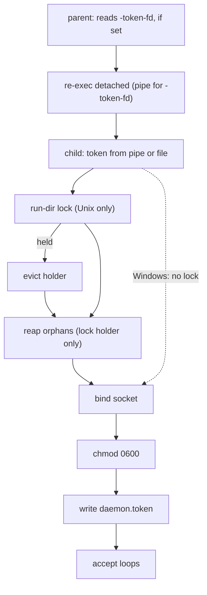
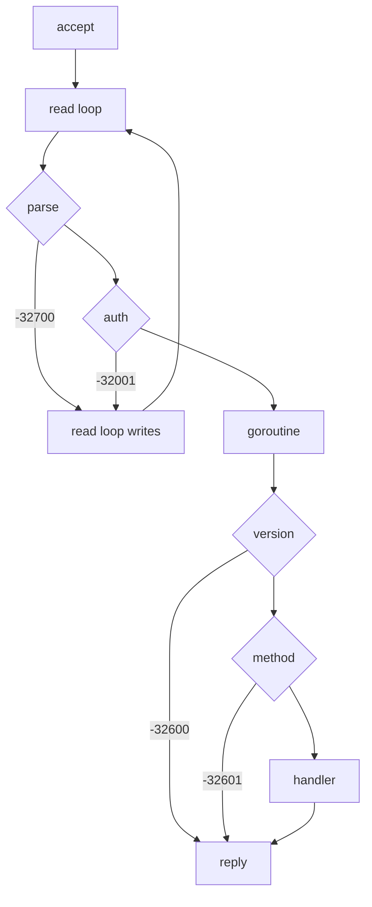
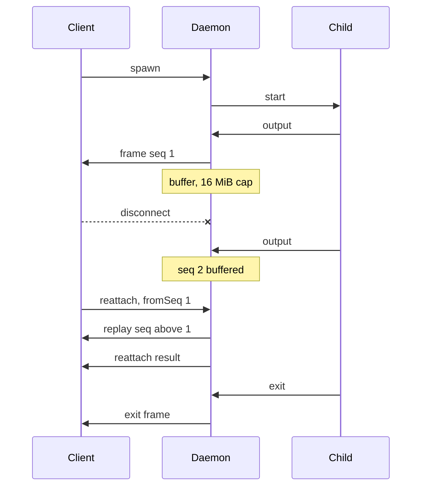

# claustrum architecture

Claustrum is one Go binary. A flag selects the mode. The build is static
(`CGO_ENABLED=0`). It has two cross-platform dependencies, `klauspost/compress`
(zstd) and `golang.org/x/sys` (system calls on Linux, macOS and Windows). One
more dependency goes into Windows builds only. It is
`github.com/Microsoft/go-winio` (the opt-in `-listen-pipe` named-pipe transport).

## Source layout (flat `package main`)

All code is in `package main`, except `handlers/prune.go`. That package holds
`handlers.PruneParams`, so the `-32602` text of `plugins.prune` names the type
of the reference byte for byte. A suffix such as `_unix` or `_windows`, or a
build tag alone, marks the part of a group for one OS. Every OS serves
the same JSON-RPC methods.

| group | files | what they hold |
|---|---|---|
| Modes | `main.go`, `config.go`, `buildstamp.go`, `bridge.go`, `selflocate_*.go`, `ignorepipe*.go` | The flags and the mode switch. `claustrum.conf`. The version stamp. `-bridge` and `-stop`. The self-locate test of `-serve`. No exit on SIGPIPE in `-install` and `-probe-cli`. |
| Transport | `server.go`, `idleconn.go`, `detach_*.go`, `dahandoff.go`, `livepred_*.go`, `peerpid_*.go`, `peercheck*.go`, `pipetransport*.go`, `raiselimit_*.go` | The `AF_UNIX` listener and the connection loop. The idle close of a connection. The self-daemonize. The socket handoff between two daemons. The peer check. The opt-in Windows named pipe. The open-file limit that children inherit. |
| Dispatch | `rpc.go`, `results.go`, `methods_*.go`, `capfeatures_*.go`, `expandpath.go`, `homeguard.go`, `filesread_*.go`, `odirectory_*.go`, `pluginsibling_*.go`, `handlers/prune.go` | The request and response types, the error codes, the dispatch order and the params gate. The result structs, whose field order is wire contract. `methods_*.go` has the 20 method handlers. The `server.capabilities` features. The `~` expansion. `wipesHomeDir`. OS parts of `files.*` and `plugins.prune`. `methods_launcher.go` also holds the settings reader, the `process.spawn` launcher checks and the child env strip. |
| Process | `process.go`, `process_signal_*.go`, `sysproc_*.go`, `execchild*.go`, `sessionsupersede.go`, `shellenv*.go`, `shellagent*.go` | The registry, seq, replay buffer and subscribers. The signal names. The kill of a child. The exec-child trampoline. The supersede of a session spawn. The login-shell PATH. The SSH agent hand-off. |
| Git | `git*.go`, `worktree*.go`, `externalunsupported_*.go`, `spelling_*.go` | See [The git subsystem](#the-git-subsystem). |
| Install | `install*.go`, `libc_*.go`, `managedlauncher*.go` | `-install` and `-probe-cli`. The download. The file test of a cache hit. The libc probe. The managed launcher. |
| Host and lock | `daemon_runlock_*.go`, `tokenpersist.go`, `childrecord*.go`, `childreap*.go`, `hostclean*.go`, `orphanexit.go`, `selfexit_*.go` | The run-dir lock. `daemon.token`. The child records and their reap. The host cleaner. The orphan exit and the idle exit. |
| Logs | `logging.go`, `metrics.go`, `wirelog.go` | The leveled stderr logger. The opt-in `/metrics` counters. The opt-in `-wire-log` capture. |
| Shared | `renameretry*.go`, `pathcanon_*.go` | The retry of a rename on Windows. The canonical form of a path. |

## The git subsystem

The five `git.*` methods start in `methods_git.go`, and their params in
`gitparams.go`.

- **Each git call.** `gitenv.go`, `gitchildenv*.go` and `githarden.go` build the
  environment of a git child. `gitstop.go` holds the time limits.
  `gitlive_*.go` tests whether a git process still runs. `gitworktreeconfig*.go`
  holds the `config.worktree` items, and the file of a new worktree.
- **Trust of a repository.** `gitdirtrust*.go`, `gitlisting.go`,
  `gitrepoconfig*.go`, `gitfilter.go` and `gitplainfile_*.go` hold the checks
  before git runs. They also read the `.git` files.
- **Settings copy.** `gitshadow*.go` holds the state and the sweep. It also
  holds the folder of one daemon under `<socket folder>/git-shadow` with its
  lock, the hold of a repository folder and the copied settings.
- **Info and status.** `gitstatus.go` and `gitinforoot_*.go`.
- **Create and remove.** `worktreecontain.go`, `worktreeexternal*.go`,
  `externalunsupported_*.go` and `spelling_*.go` hold the path refusals of both.
  `worktreelock.go` holds their locks. `worktreebranch*.go` holds the branch
  step of a remove and of a rollback.
- **Create.** `gitdiraccept.go` and `gitdirheld.go` hold the git directory open
  and act through it. On Linux and macOS `gitshadowuse.go` also holds the
  `worktree add` steps. `worktreeverify.go` holds the tests after the add and
  the rollback steps. `githarden_index_*.go` places the index. For a create
  that holds no git directory, it deletes the registration of a rollback.
  `worktreestaging.go` is the Windows staging step. The copy steps
  are `worktreecopy.go`, `worktreeinclude*.go` and `worktreeclaude.go`. The
  other steps are `worktreemkdir_*.go`, `worktreestale*.go` and
  `worktreesource.go`.
- **Remove.** `worktreeremove.go`.

[`AGENTS.md`](https://github.com/schubydoo/claustrum/blob/main/AGENTS.md) names
the delete paths of these files and their guards. The page of each method has
its rules, as in [git.worktree_create](protocol/git-worktree-create.md).

## The three runtime roles

### 1 · CLI-version manager (`-install`)

This mode makes sure the pinned `claude` CLI is present under `-cli-dir`.
Claustrum decompresses the source with zstd to a temp path. It verifies a
supplied `-cli-checksum`, always on `-cli-url`. Then it applies `chmod 0755` and
renames the file into place atomically.
[-install and -probe-cli](INSTALL.md) has the sources, the bounds, every
delete, the prune and the `__INSTALL_RESULT__` facts.

### 2 · Daemon / process supervisor (`-serve`)

Claustrum daemonizes itself: it detaches from the controlling session and, on
Unix, reparents to init. It then binds the socket and sets its mode to `0600`.
On Linux and macOS, the run-dir lock and, for its holder, the orphan reap come first. Most rules are in PROTOCOL.md and [Running the daemon](DAEMON.md). This list
names the files, the seams and the rules with no other home.

- **Token.** `-token-file` or `-token-fd` gives the token. `tokenpersist.go`
  writes `daemon.token` and unlinks it at a graceful stop if it is still its
  own file. See
  [The token source](PROTOCOL.md#the-token-source) and
  [Token persistence](DAEMON.md#token-persistence-daemontoken).
- **Re-exec sentinel.** An internal sentinel, `CLAUSTRUM_DAEMON_CHILD`, gates the
  self-daemonize re-exec. It is *not* the
  reference's `CLAUDE_SSH_DAEMON_CHILD`. A surrounding claude-ssh session exports
  that name to every descendant. If claustrum used that name as its sentinel, the
  launcher mistakes itself for the child and skips its own daemonize and
  token-forward path. The child unsets the sentinel after it reads it. Parity
  comes by a separate route. `daemonizeWithToken` still sets
  `CLAUDE_SSH_DAEMON_CHILD=1` in the daemon's environ, so `process.spawn` children
  inherit it as they do under the reference (see
  [The re-exec marker](PROTOCOL.md#the-re-exec-marker)).
- **Identity markers.** On Linux and macOS each `process.spawn` child starts
  through the exec-child trampoline, or directly when the trampoline does not
  start: `execchild_unix.go`, with the start-time
  source in `execchild_linux.go` and `execchild_darwin.go`. The target's Go-runtime
  env is held and restored across the re-exec. See
  [process.spawn](protocol/process-spawn.md#the-identity-markers-linux-and-macos).
- **Child records and the reap.** `childrecord.go`, `childrecord_unix.go` and
  `childrecord_linux.go` / `childrecord_darwin.go` write and remove the records.
  `childreap.go`, with the live-process read in `childreap_linux.go` /
  `childreap_darwin.go`, reaps them at the start. Both act through the run dir that
  the daemon holds open, so no write or read follows a symlink out of it. The kill
  and every live-process read sit behind package-var seams, so tests end no real process. See
  [Child records and the reap](DAEMON.md#child-records-and-the-reap-linux-and-macos).
- **Host cleaner.** `hostclean.go` holds the shared decision layer, and
  `hostclean_linux.go` / `hostclean_darwin.go` hold the OS reads. Windows links no
  cleaner. Its rules and log lines are in
  [Host cleaner](DAEMON.md#host-cleaner-off-wire-linux-and-macos).

  This path is destructive and host-wide. Every process read, kill, dial, rename
  and remove sits behind a seam, and tests never touch a real process. A test that
  lets a rename or a remove run for real does so inside its own temp dir. Test the
  real cleaner only on a disposable machine, never on a host that runs other
  daemons.
- **Login-shell PATH.** `shellenv_unix.go` runs the read at the first
  `process.spawn`, in a process group of its own. At the 4 s cap it kills that
  group. `shellenv_windows.go` reads the daemon's own PATH. See
  [The login-shell PATH](protocol/process-spawn.md#the-login-shell-path-linux-and-macos).
- **Named pipe.** With `-listen-pipe` (Windows only, opt-in) a second
  `acceptLoop` serves the same `serveConn` over a named pipe
  (`pipetransport*.go`). See
  [Named-pipe transport](PROTOCOL.md#named-pipe-transport-windows-opt-in).
- **Network.** The daemon makes no outbound network connections. Every dial it
  makes is to a local `AF_UNIX` socket. It opens no inbound listener beyond the
  socket unless the operator opts into `-metrics-addr` (TCP) or `-listen-pipe`.

### 3 · JSON-RPC multiplexer + replay

This role serves one socket with concurrent dispatch and in-band token auth.
Each process keeps a frame buffer, and `reattach` replays it.

(`-bridge` is a fourth mode: a stdio↔socket relay that SSH attaches to. It
injects no auth.)

## Concurrency & replay model

- Each request that passes parse and auth runs in its own goroutine. A mutex
  serializes the per-connection writer, so responses and stream frames
  interleave safely.
- Each managed process has a monotonic `seq`, an append-only frame buffer, and a
  set of subscriber connections. `spawn` subscribes its connection. `reattach`
  REPLACES the whole subscriber set with the requester, replays frames with
  `seq > fromSeq`, and closes each connection that it displaced. Claustrum detaches a dead
  subscriber (`[frameSink] replay write failed, detaching`).

## Deployment lifecycle (how a driver uses it)

A driver (Claude Desktop, or your own tool such as clauster) typically does this:

1. Probes the remote OS and arch.
2. Makes sure the daemon binary is present on the remote.
3. Runs `claustrum -install …` for the agent CLI.
4. Starts `claustrum -serve -socket … -token-file …`.
5. Attaches per session with `claustrum -bridge -socket …` and speaks JSON-RPC
   through it.
6. Drives the agent and any MCP servers as `process.spawn` children. It writes to
   each child's stdin with `process.stdin` (base64), and it reads that child's
   stdout from the stream notifications.

## Inherited wire bytes

Go's standard library, not claustrum's code, produces some of claustrum's
byte-identical output. The reference is also a Go program, so inherited
agreement is agreement nobody verified.

Two things follow: a Go upgrade that changes an escaping rule moves the wire,
and this repo shows no diff. A reimplementation in another language must
re-derive every row below by hand.

The stdlib decides the rows marked **inherited**. **Deliberate** means claustrum
chose the mechanism *because* it reproduced the reference, after someone
measured it.

| Surface | Where | Source | Status |
|---|---|---|---|
| `id` echo: `1.0`→`1`, `1e2`→`100`, big-int precision loss, map keys sorted | `rpc.go` (`request.ID interface{}`) | `encoding/json` round-trip through `interface{}` | **deliberate**. `json.RawMessage` reproduced none of it. Measured |
| Invalid UTF-8 in a result string → one `\ufffd` escape per bad byte. NUL → `\u0000` | `files.read` `content`, any string field | `encoding/json` encode | inherited |
| `<` `>` `&` → `\u003c` `\u003e` `\u0026` | every string field and error message | `encoding/json` HTML escaping, on by default | inherited |
| Invalid UTF-8 in a request param replaced with U+FFFD before dispatch sees it | every path param | `encoding/json` decode | inherited |
| `chdir 
: stat 
: no such file or directory` | error messages built from `err.Error()` | `os` `*PathError` (`op + " " + path + ": " + errno`) | inherited |
| Frame `data` alphabet and `=` padding | `process.*` stdout/stderr frames | `base64.StdEncoding` | inherited |
| Result field ORDER | `results.go` | `encoding/json` emits struct fields in declaration order | **deliberate**. Order is chosen to match, and results are structs, never maps, precisely because maps sort |
| Path cleaning for `~`-prefixed paths | `expandpath.go` | `filepath.Join`/`Clean` | **deliberate**. The lexical clean was measured and matched (PR 205) |

The decode-side row is the one row with a user-visible consequence: a file
whose name is not valid UTF-8 cannot be addressed through the protocol at all,
on either daemon. The request decoder substitutes U+FFFD before any method runs,
so the daemon operates on a name that does not exist. The reference behaves
the same way. Keep it: changing it moves inherited wire bytes.

`inherited_encoding_test.go` and `inherited_encoding_unix_test.go` pin these
rules against regression. For the encode-side rules they assert escape TEXT
(`\ufffd`). For the decode-side rule they assert the U+FFFD CHARACTER.

## Operational logging

The logs are not wire contract. The log file, the startup lines and the
differences from the reference are in [DAEMON.md → Daemon
log](DAEMON.md#daemon-log-remote-serverlog).

The readiness banner `Claustrum remote server listening on <socket> (pid <pid>,
instance <id>)` goes to stdout with no prefix. The leveled logger in
[`logging.go`](https://github.com/schubydoo/claustrum/blob/main/logging.go)
writes to stderr through the stdlib `log` package, which adds a
`2006/01/02 15:04:05` timestamp. The logger puts a level tag (`DEBUG`, `INFO`,
`WARN` or `ERROR`) before the `[Component]` prefix. So a grep for a prefix such as `[Server]` or `[process.Manager]` keeps matching.

`CLAUSTRUM_LOG_LEVEL` (`debug`, `info`, `warn` or `error`) sets the threshold
once, at startup. An unset or unknown value means `debug`, which emits every
line. A higher threshold drops each line below it. The wire never changes.

## Driver claims and their provenance

A few facts these docs rely on describe a third binary: the driver (Claude
Desktop, or a tool such as clauster). A comparison of two daemons cannot settle
them. Three of them carry rules of these docs:

- `cliError` classification. The driver reads `cliError` as text. It shows a
  disk-full-shaped message as a terminal error with an actionable code, and
  everything else as retryable. A failed `-cli-url` download with another
  `cliError` got a further attempt from Desktop. That does not tell a read of
  the text from a reaction to any failure, and the terminal side is not
  observed.
- `libc` build selection. The driver uses the `libc` field of
  `__INSTALL_RESULT__` to pick the CLI build to download.
- "Desktop owns the argv". An operator cannot change the daemon's argv, so a
  divergence that only an argv flag reaches is unreachable on Desktop-driven
  hosts. This premise lets D3, D10 and D12 be opt-in. It also defines the
  "(opt-in)" convention: a flag and a configuration key, because the key is the
  reachable knob.

Two driver claims have no fixture: what Desktop sends as `-cli-version` (D6),
and that Desktop stops the daemon with no token
([Authentication](PROTOCOL.md#authentication)).

Each claim has a fixture and a control that can come out wrong. Only the argv fixture was run.

| claim | fixture | control that must fire |
|---|---|---|
| `cliError` | two `-install` failures whose messages straddle the disk-full shape. Observe a retry or a terminal report | a real disk-full failure shows as terminal with an actionable code |
| `libc` | a stub `ldd` that prints a musl banner, so the daemon reports `musl`. The exit code of `ldd` is not read, and its output outranks the loader glob ([REFERENCE-BUILDS.md](REFERENCE-BUILDS.md)). See which build the driver fetches | a glibc host fetches the glibc build, so the musl arm differs from the default |
| argv | find where the shipped client builds the daemon's argv. Check the setup UI, a capture of the argv, and Desktop's configuration files | an argv built from a setting or a configuration file makes the claim false |

The argv claim holds, by inspection of the shipped client. Desktop builds the
daemon's argv from a fixed set of flags. Only the operands change: the download
URL, its checksum and the uploaded blob path. The argv capture of 2026-08-10 (two cold starts and one `-cli-zst` call) shows these shapes ([REFERENCE-BUILDS.md](REFERENCE-BUILDS.md#7c2f88d13e5f269762dd4d463aa4eb3102214110-2026-07-02)).

The `cliError` claim underpins D10.
`libc` underpins no current entry. This list is kept by hand and is not
complete. Each entry in [DIVERGENCES.md](DIVERGENCES.md) has its own reopen
trigger.

If someone finds a route to the daemon's argv, or a Desktop release adds one,
the argv claim reopens. Such a route is a new configuration field, or a
configuration file that Desktop turns into argv. A forwarded env var is not one,
because nothing in `config.go` or `main.go` reads the environment for these
knobs.
