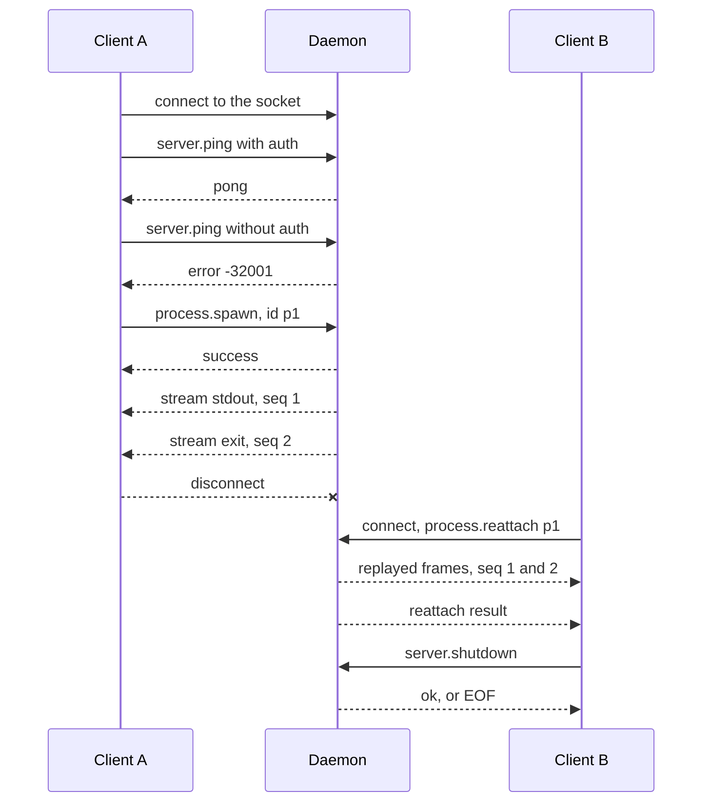

# Tour of one session

This tour follows one client from connect to shutdown and shows the frames in order. It takes about five minutes to read and needs no running daemon. To run the same calls yourself, start a daemon as in [Worked client sessions](EXAMPLES.md#start-a-private-daemon).



Each frame below is one line on the wire. A frame marked **exact** is a line of a golden fixture under `testdata/`, or a frame that a test asserts byte for byte. A frame marked **example** has no such source, and its method page is linked. The token `s3cret-token` is the fixed token of the test suite.

## Step 1: Connect

Connect to the `AF_UNIX` socket of the daemon. The connection stays open, and each frame is one line of JSON. See [Transport](PROTOCOL.md#transport).

## Step 2: Send an authenticated request

Every request carries the token in its `auth` member. See [Authentication](PROTOCOL.md#authentication).

Request (**exact**: `integration_test.go:95` with the `auth` member that `authed` adds in `harness_test.go:174`):

```json
{"jsonrpc":"2.0","id":1,"method":"server.ping","auth":"s3cret-token"}
```

Reply (**exact**: `testdata/socket_responses.golden.json`, the entry with `"id": 1`):

```json
{"jsonrpc":"2.0","id":1,"result":{"pong":true}}
```

## Step 3: See an unauthorized reply

Send the same request with no `auth` member. The daemon answers with the error `-32001` and echoes your `id`. A wrong token gets the same reply.

Request (**exact**: `integration_test.go:99`):

```json
{"jsonrpc":"2.0","id":5,"method":"server.ping"}
```

Reply (**exact**: `testdata/socket_responses.golden.json`, the entry with `"id": 5`):

```json
{"jsonrpc":"2.0","id":5,"error":{"code":-32001,"message":"Unauthorized: invalid or missing auth token"}}
```

## Step 4: Start a process

[process.spawn](protocol/process-spawn.md) starts a child and names it with your `id`.

Request (**example**, see the [request](protocol/process-spawn.md#request)):

```json
{"jsonrpc":"2.0","id":2,"method":"process.spawn","params":{"id":"p1","command":"echo","args":["hello"]},"auth":"s3cret-token"}
```

The `result` member of the reply is **exact** (`testdata/socket_process_wantpid.golden.json`, entry 0). The envelope around it is the same as in step 2:

```json
{"success":true}
```

With `"wantPid":true` in the params, the result has two more members. The golden stores them as placeholders, because the real values change on each run (entry 1):

```json
{"success":true,"pid":"<PID>","startTime":"<TS>"}
```

`<PID>` stands for the OS process id and `<TS>` for the start time token. A real reply holds numbers there. See [CT-1](DIVERGENCES.md#ct-1).

## Step 5: Read the stream

After the result, the output of the child arrives as id-less stream frames. The `data` member is base64. The last frame has `"stream":"exit"`. See [Stream notifications](PROTOCOL.md#stream-notifications).

Both frames are **exact** (`results_test.go:110-113`). The test uses `AAA` as a stand-in for the data. A real frame holds the base64 of the output, for example `aGVsbG8K` for `hello` and a newline:

```json
{"type":"stream","processId":"p1","stream":"stdout","seq":1,"data":"AAA"}
{"type":"stream","processId":"p1","stream":"exit","seq":2,"exitCode":0}
```

## Step 6: Disconnect

Close the socket. Nothing is sent. The child is not tied to your connection. See [process.spawn](protocol/process-spawn.md).

## Step 7: Reattach and replay

Open a new connection, send the token again, and ask for the frames after `fromSeq`. With `0`, you get each stored frame. The daemon sends the stored frames first and the result last. See [process.reattach](protocol/process-reattach.md).

Request (**example**: the shape of `integration_test.go:333` with the id `p1`):

```json
{"jsonrpc":"2.0","id":1,"method":"process.reattach","params":{"id":"p1","fromSeq":0},"auth":"s3cret-token"}
```

Frames (**example**: the two frames of step 5, sent again):

```json
{"type":"stream","processId":"p1","stream":"stdout","seq":1,"data":"AAA"}
{"type":"stream","processId":"p1","stream":"exit","seq":2,"exitCode":0}
```

Reply (**example**, see the [response](protocol/process-reattach.md#response)):

```json
{"jsonrpc":"2.0","id":1,"result":{"found":true,"running":false,"firstSeq":1,"lastSeq":2,"stdinApplied":0}}
```

## Step 8: Shut the daemon down

[server.shutdown](protocol/server.md) is the one method with no `auth`. It is what `-stop` sends.

Request (**exact**: `daemonlines_test.go:179`):

```json
{"jsonrpc":"2.0","id":2,"method":"server.shutdown","params":{}}
```

Reply (**example**, see [the reply races the close](protocol/server.md#the-reply-races-the-close)). The client can also read EOF with no bytes:

```json
{"jsonrpc":"2.0","id":2,"result":{"ok":true}}
```

## What you learned

- The frames of a session: [Protocol overview](PROTOCOL.md).
- More calls, with a runnable client: [Worked client sessions](EXAMPLES.md).
- Every method: the pages under `protocol/`, starting at [process.spawn](protocol/process-spawn.md).
- Start and stop a real daemon: [Running the daemon](DAEMON.md).
