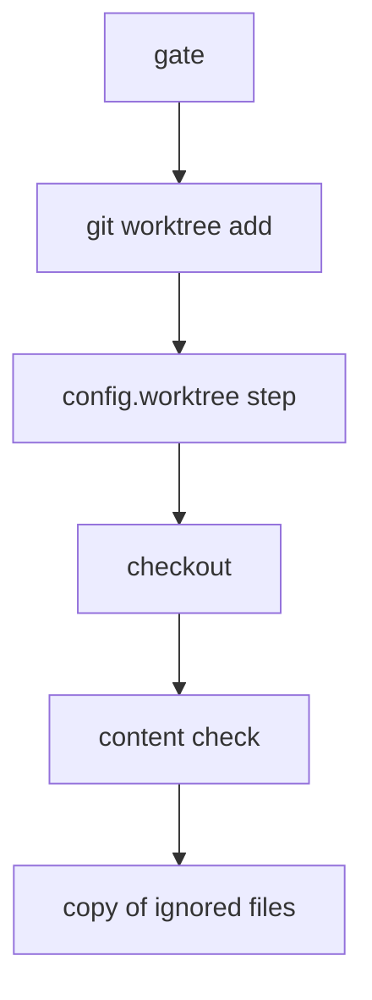

# git.worktree_create

`git.worktree_create` makes a linked git worktree for a session. It creates a new branch, or attaches the worktree to one that exists, then checks out the tracked files and copies some ignored files into it. [After a failure](#after-a-failure) lists what a failed create leaves.

An untagged rule on this page matches the reference as measured on `5fd08069` or on an earlier build.

## Request

```json
{"baseRepo": "/repo", "branchName": "feature", "worktreePath": "/repo/.claude/worktrees/w1"}
```

| Parameter | Required | Meaning |
|---|---|---|
| `baseRepo` | yes | The repository. |
| `branchName` | yes | The branch to create. It is required with `existingBranch` too. An attach that succeeds does not use it. |
| `worktreePath` | yes | The directory of the new worktree. It must not exist. |
| `sourceBranch` | no | The name that the new branch starts from. The default is the current branch. An attach does not use it. |
| `existingBranch` | no | A local branch to attach to. If it names no local branch, or the attach fails, the daemon creates `branchName` instead. |
| `worktreeRoot` | no | A location outside the repository. Windows refuses it with `unsafe_path` and `` refusing to create worktree: `<root>` cannot be used: a custom worktree location is not supported on Windows hosts yet `` (`c9125eb8` and `4c111e86`, measured on Windows). |
| `timeoutMs` | no | A deadline that starts before the first git call. It stops the read-tree call, and [the content check](#the-content-check) at a step that sees it. The daemon tests it after the add and the copy step. The stop of the settle step from that start is measured (`683cc6a9`, Linux). For the other tests that start is claustrum's own, not measured. A wait at the add behind another create of the repository counts (claustrum's own, not measured). No value or `0` sets none. |
| `shadowDirOff` | no | `true` turns off, for this request, the filter rule of the checkout, the daemon's own read of the repository's git config, the settings copy and the content check. Git requests that start meanwhile get the same. A command that starts meanwhile gets no copy (measured on Linux). Other values do nothing. |

Where the worktree can go:

- Without `worktreeRoot`, `worktreePath` must be an absolute path inside `baseRepo`. The usual place is `<baseRepo>/.claude/worktrees/<name>`.
- With `worktreeRoot`, `worktreePath` must be `<worktreeRoot>/<directory>/<name>`. A root that exists must belong to the user of the daemon. Its mode must have no write bit for others, or for a group other than the private group of that user.
- Neither a component of the location nor the `<directory>` can be `.git` or `.claude-managed-worktrees`, in any letter case. The location must not resolve to `/`. It must not lie in a folder with a `.git` entry, the git directory of the repository, or the folder of a Claude Code session. The `<directory>` level must not hold the repository or be writable by every user.
- Not measured on the reference: `.claude-managed-worktrees` in the location, a reserved `<name>`, and the owner and group tests of the `<directory>` level. claustrum refuses all of them.

## Response

Success:

```json
{"success": true, "path": "/repo/.claude/worktrees/w1", "sourceBranch": "main", "branch": "feature"}
```

`path` is `worktreePath` as sent, after the `~` expansion. `branch` is `existingBranch` after an attach, and `branchName` otherwise.

If the daemon created a branch, `sourceBranch` is the name that the start commit came from. The daemon reads that name as two refs: the local branch `<name>` and the remote-tracking ref `origin/<name>`. It fetches nothing. If both exist, it selects `origin/<name>` in most states. The response holds the name as sent. If the name matches neither ref, the branch starts at HEAD with no error, and `sourceBranch` is the current branch. On a detached HEAD the response then has no `sourceBranch`.

Failure:

```json
{"success": false, "error": "<text>", "errorCode": "<code>"}
```

Decide by `errorCode` first.

| `errorCode` | Meaning |
|---|---|
| `unsafe_path` | The daemon refuses a path. For example, `worktreePath` is relative, has a `..` component, is outside `baseRepo`, or exists. An unsafe `worktreeRoot` and a worktree that git registered in an unexpected place give this code too. |
| `symlinked_component` | A directory between `baseRepo` and the worktree is a symbolic link. |
| `not_a_repo` | `baseRepo` is not a git repository, as with `refs` 0600 (`52d82f0a`, Linux and macOS), or git does not accept it. A bare `baseRepo` gets this code too while the daemon works on its settings copy. |
| `git_not_found` | No git on the daemon's PATH and none that it uses on the login shell's PATH ([the git of the login shell's PATH](git-rules-calls.md#the-git-of-the-login-shells-path)). The text is `not a git repository` (`87375cc7`, measured on Linux and macOS, and on Windows for a missing `baseRepo`). `4c111e86` answers `not_a_repo`. An existing `baseRepo` on Windows is claustrum's own. |
| `git_lfs_not_found` | Linux: the git of the login shell's PATH runs, and the checkout fails for a git-lfs that is on the login shell's PATH but neither beside that git nor on the daemon's PATH. The stderr of the checkout holds `git-lfs: not found` (measured with dash as `/bin/sh`). With bash as `/bin/sh` the create answers `worktree_add_failed` (claustrum's own, not measured). The text is `not a git repository`, and one line names the text of the checkout (`87375cc7`, measured on Linux). The undo of a failed checkout that comes first is claustrum's own, and its text can follow `not a git repository`. The words "neither beside that git" come from the log text, not measured. With git-lfs on no PATH the checkout failure stays. macOS gives `worktree_add_failed` (measured). |
| `nested_base_repo` | `baseRepo` is inside a directory of managed worktrees ([the marker rule](git-list-branches.md#response)), or is no trust root of the daemon. A marker above the path as sent counts too (`b3081b51`, measured on Linux). A missing `baseRepo` gets `not_a_repo` with no [start test](git-rules-settings-copy.md#the-start-test) (`4c111e86`, measured on all three systems), and a later Windows create makes no git call. Every other missing cause, such as `<T>/missing/..` on Linux and macOS, is claustrum's own. So are no `git version` call on Linux and macOS and the early answer to `"shadowDirOff":true`. On Windows `<out>\J\..\repo` (J a junction), `<T>\missing\..` and `<T>\t.txt\..` pass as the folder that `..` leaves, and the create makes the worktree there ([the walk](git-worktree-remove.md#where-the-paths-can-be), `b3081b51`, measured on Windows). A refused daemon count [answers first](git-rules-calls.md#where-each-method-answers-the-refusal) (from the code). |
| `mkdir_failed` | The daemon cannot create a directory for the worktree. Or, with `worktreeRoot`, a git call or a `.git` test failed first. |
| `worktree_add_failed` | `git worktree add`, the checkout or the `config.worktree` step failed. The text holds the message of git, or a refusal of the daemon before the add. A `git worktree add` that runs 2 minutes is stopped. |
| `repository_only_filter` | The checkout needs a git filter that only the git config of the repository defines. See [Git filters](#git-filters). |
| `timeout` | The deadline of `timeoutMs` expired. |
| `worktree_no_space` | A write of git-lfs in [the private LFS store](#the-private-lfs-store) met a full disk. |
| `worktree_quota` | A write of git-lfs in the private LFS store met a used-up disk quota. |
| `worktree_lfs_not_kept` | The deadline of `timeoutMs` expired during the checkout after a long copy into the private LFS store, or after Git LFS downloads began with a downloaded file that cannot be kept. |
| `worktree_lfs_no_space` | A Git LFS download left under a tenth of the free space at the start, and the daemon stopped the checkout. |
| `worktree_verify_content` | A file of [the content check](#the-content-check) does not match the commit, or is not executable though the commit records it so. |
| `worktree_verify_link` | A committed link of the content check leads to the top of the new worktree, runs in a circle, or passes through `/proc` or `/dev/fd`. |
| `worktree_verify_retry` | A file of the content check cannot be read, or git cannot hash the commit for the content check. |
| `worktree_verify_other_writer` | A file of the content check is in the new worktree but not in the commit. |
| `worktree_verify_repository` | git cannot read an object of the commit for the content check. |

A git config of the repository that the daemon does not accept gives `worktree_add_failed`, and nothing is made ([the texts](git-rules-config.md#repository-config-refusals)). Three settings copy failures do the same: a failed host git test, a failed call about the repository, and no copy folder.

## Error texts

Each text is in `error`, unless the row names a JSON-RPC error. The shared texts are in the [error-string catalogue](errors.md#error-string-catalogue). A row with no mark holds a text of the reference, measured on Linux. A mark such as "measured on macOS" limits its sentence to that system. A sentence that names systems without "measured" holds on each one.

### Request, path, folder and post-add refusals

| Text | Code and cause |
|---|---|
| `branchName is required` | JSON-RPC error `-32602` |
| `not a git repository` | `errorCode:"not_a_repo"`/`"git_not_found"` |
| ``Git can't use `<path>`, so Claude made no worktree. A Claude session can damage it, so check it first. Then repair it, or turn off Worktree if this isn't meant to be a repository.`` | `errorCode:"worktree_add_failed"`, where the create gave `not_a_repo` and [the walk](git-rules-trust.md#how-the-daemon-finds-the-git-directory) met a `.git` that git cannot use. `<path>` is that `.git` as the walk spells it. Nothing is made. `4c111e86` measured this on Linux, macOS and Windows for an empty `.git` folder, one with no HEAD and a nested empty `.git`, and a `.git` file with no `gitdir: ` line. A garbage HEAD is measured on Linux and Windows, and a `.git` folder of junk only on Linux. A `.git` file that is empty, names a missing path or an empty folder is measured on Windows (git 2.55), a missing path on each system (git 2.56.1). A dangling link and a FIFO count too, and below a good repository they pass (Linux and macOS). A `.git` file that names a file gets the text too (claustrum's own, not measured). A link loop at `.git` and a `.git` folder of mode 0000 count too (`4c111e86`, measured on macOS). An empty `.git` folder in a folder of another account than the daemon's keeps `not_a_repo`. A folder whose parent alone belongs to another account gets the text (both measured on macOS). A root daemon answers `not_a_repo` for an empty `.git` in a folder of the user (claustrum's own, not measured). Linux is claustrum's own here. Windows is claustrum's own, not measured. A refused `.git` folder of `baseRepo` or its parent on a Windows share counts (`4c111e86`, measured). Other share cases are claustrum's own. Also claustrum's own: a `.git` folder of mode 0600 counts. Another part that the daemon cannot read or search, a daemon `GIT_DIR`, and a daemon `GIT_COMMON_DIR` that the request keeps ([the Windows rule](git-rules-trust.md#the-daemon-variables-on-windows)), keep `not_a_repo` |
| ``Claude couldn't look into `<dir>` for a repository, so it made no worktree. Check that your account on the remote machine may open that folder, or turn off Worktree.`` | `errorCode:"worktree_add_failed"`, where the daemon cannot search the folder `<dir>` for its `.git`. `<dir>` is the folder as the walk spells it. Nothing is made (`4c111e86`, measured on macOS for a folder of mode 0600 or 0000 that holds a `.git`). Linux is claustrum's own, and Windows keeps `not_a_repo` (claustrum's own, not measured) |
| `refusing to create worktree: <p> {is a relative path / contains a ".." component / has a component Windows reads as a different name (trailing dot or space, or a colon) [Windows] / is not inside the repository <repo>; … / already exists, …}` | `errorCode:"unsafe_path"`. The spelling refusal is Windows only and comes before containment. Without `worktreeRoot` the relative-path text puts `<p>` in backticks (`4c111e86` and `c9125eb8`, measured on Linux, claustrum's own on macOS and Windows). In the `is not inside` text `<p>` is in backticks and `<repo>` is as sent (`be1c1ca5`, measured on Linux and macOS). A path with a backtick is quoted as in Go, and a path over 300 bytes is cut (from the code, not measured). The `already exists` text puts `<p>` in backticks too (`be1c1ca5` and `b3081b51`, measured on Linux without `worktreeRoot`). With `worktreeRoot` it is claustrum's own, not measured. macOS and Windows are not measured. Its quoting and cut follow the `is not inside` text (from the code, not measured). On Linux and macOS the `already exists` text cleans `<p>` and resolves its parent folder, not its last name. An absent `baseRepo` gives an empty `<repo>`. With `worktreeRoot`, the first two texts also refuse a relative, absent or `..` `baseRepo`, and `<p>` is then `baseRepo` as sent |
| `refusing to create worktree: <root> is a filesystem root; choose the worktree location by its absolute path, without "..", beneath the filesystem root` | `errorCode:"unsafe_path"`, Linux and macOS, with `worktreeRoot`. A root of `/`, `//` or `/.` is refused, also with the folder gone and for a root daemon. `<root>` is `worktreeRoot` as sent. A root that is another mount point passes. A relative `worktreePath` gets its own text first. A root with a `..` component that cleans to `/` gets the `..` text (from the code, not measured). Windows refuses every `worktreeRoot` first. Nothing is created |
| ``refusing to create worktree: `<c>` is a symbolic link; a symlinked .claude or .claude/worktrees …`` | `errorCode:"symlinked_component"`, for a symlinked ancestor component under the repo. `<c>` is in backticks, and a path with a backtick is quoted as in Go. `be1c1ca5`, measured on Linux, macOS and Windows. A path over 300 bytes is cut (not measured) |
| `failed to create parent directory: "" does not name a directory` | `errorCode:"mkdir_failed"` (empty `worktreePath`, without `worktreeRoot`) |
| `failed to create parent directory: <repo>\<component> is not a directory` | `errorCode:"mkdir_failed"`, Windows, when a directory between `baseRepo` and the leaf is a junction. `<repo>\<component>` is the path of the first junction. No directory, entry or branch is created. claustrum refuses a non-symlink reparse point that is not a junction the same way (not measured) |
| `` refusing to create worktree: `<root>` is the repository <repo> or inside it; a worktree location must be outside the repository `` | `errorCode:"unsafe_path"`, with `worktreeRoot`. A root that is `baseRepo` or lies beneath it by whole components is refused. `<B>/Tx` beside `<B>/T` passes. `<root>` (in backticks, `b3081b51`, measured on macOS) and `<repo>` are as sent. claustrum cleans both paths first, as on remove (not measured on create). Nothing is created. Measured on Linux and macOS. |
| `refusing to create worktree: <root> passes through <dir>, which is writable by <who> without the sticky bit (mode <mode>), so they could replace what is beneath it; choose a location under directories only you (or the system) control, or remove the extra write permission (chmod go-w)` / `refusing to create worktree: <root> passes through <dir>, which is owned by uid <uid>, neither you nor the system; choose a location you reach through your own directories` | `errorCode:"unsafe_path"`, Linux and macOS, with `worktreeRoot`. It tests each directory above the root, not the root. For a symlinked root, those above its target count too. The second text names an owner other than uid 0 and the daemon's user, also with the sticky bit set. A group-write bit passes for the private group of the daemon's user, as in the root's own write test. uid 0 gets no exemption from the write tests. `<dir>` is the first failing directory of the walk from `/`, with its symlinks resolved, also one that the daemon cannot search. A symbolic link above the root that another user owns gets the second text. `<dir>` is then the link as written in the root. `<root>` is `worktreeRoot` as sent. `<who>` is "its group", "every user on this host" or "its group and every user on this host". `<mode>` is four octal digits of the permission bits, so 2775 prints `0775`. `<uid>` prints unsigned, for example 4294967294 on macOS. On macOS a firmlink spelling of the root names `/System/Volumes/Data`. A missing level or another failed resolve ends the walk with no refusal. A create without `worktreeRoot` and `git.worktree_remove` run no ancestor test. Nothing is created. The comment of `worktreeRootAncestorRefusal` lists claustrum's own cases |
| `refusing to create worktree: <root> leads into the repository <repo> (at <at>); a worktree location must be outside the repository` | `errorCode:"unsafe_path"`, with `worktreeRoot`, Linux and macOS. The root passes the tests above but leads into the repository: the git top level of `baseRepo`, the main checkout or the git directory, also a separate one. The [remove row](git-worktree-remove.md#error-texts) gives its test. claustrum compares file identity as on remove (not measured on create). When the ancestor test refuses the same root, its text answers. `<repo>` is `baseRepo` as sent. Nothing is created |
| `refusing to create worktree: <root> leads into <wt>, a worktree of the repository <repo> (at <wt>); a worktree location must be outside the repository's checkouts` | `errorCode:"unsafe_path"`, with `worktreeRoot`, Linux and macOS. The root lies in a linked worktree `<wt>` of the repository. The [remove row](git-worktree-remove.md#error-texts) gives its test. `<repo>` is `baseRepo` as sent. A listed worktree whose folder is gone refuses too. The create makes that folder first, with mode 0700. Nothing else is created |
| ``refusing to create worktree: `<root>` is inside a git checkout (<dir> has a .git entry); a worktree location must be outside every checkout, so that no session working in one can reach it — choose a directory that is not part of any repository`` | `errorCode:"unsafe_path"`, Linux and macOS, with `worktreeRoot`. A directory from `/` down to the root holds a `.git` entry of any kind. A missing directory is skipped. The ancestor text answers first at the same directory. `<root>` is `worktreeRoot` as sent, with a trailing slash or `//` kept. It is in backticks (`4c111e86` and `c9125eb8`, measured on Linux). macOS follows Linux (not measured). A root over 300 bytes is cut, and one with a backtick is quoted as in Go, here and in the `leads into` and `is itself` texts (from the code, not measured for these texts). `<dir>` is the highest such directory, resolved and cleaned. Nothing is created |
| `refusing to create worktree: <dir> is itself a git checkout (it has a .git entry); a worktree location must be outside every checkout` | `errorCode:"unsafe_path"`, Linux and macOS, with `worktreeRoot`, when the `<directory>` level holds a `.git` entry. `<dir>` has the symlinks of the root resolved. Nothing is created |
| `refusing to create worktree: <p> carries a .git file that does not name this repository's own worktree admin directory` | `errorCode:"unsafe_path"`, Linux and macOS, after a successful add. `<p>` is spelled as in the `already exists` text, without backticks. The `gitdir:` path of the new `.git` file is not in a folder named `worktrees`. Or it names no entry of the `worktrees` folder of `baseRepo`, or a symbolic link. Or the `commondir` file of the registration does not name the git directory by text. Or that `commondir` file or the `gitdir` record cannot be read as a file |
| `refusing to create worktree: <p> was not populated by git worktree add` | `errorCode:"unsafe_path"`, Linux and macOS, for a `.git` swapped right after a held add with no copy, with no rollback (from the code) |
| `refusing to create worktree: <p> carries a .git file naming an admin directory whose own record is of a different worktree` | `errorCode:"unsafe_path"`, after a successful add. The `gitdir` record of the registration does not name `<p>/.git`. A record with a slash or a blank at its end, a `/./` part or a double slash names it. An expired `timeoutMs` gets it too |
| `git worktree add failed (verification): could not verify the worktree's registration: git did not report its spelling of the path (entry <name>); retry` | `errorCode:"worktree_add_failed"`, Linux and macOS. The state above, and the next `rev-parse --show-toplevel` fails. `<name>` is the entry that the `.git` file names. The leaf, the one new entry of the `worktrees` folder and the new branch go. claustrum's own, not measured: the folder has one new entry, and no time limit stopped the call |
| `refusing to create worktree: <p> carries a .git file naming an admin entry other than the one just created for it` | `errorCode:"unsafe_path"`, after a successful add. The registration is not the one new name of the `worktrees` folder since the listing before the add: there are two new entries, or none. claustrum's own, not measured: a `.git` file of the staged leaf that names another entry (Linux and macOS) and a failed listing get it, and a refusal of the four rows above comes first |
| `refusing to create worktree: <p> has no .git file` / `refusing to create worktree: <p>/.git is not a regular file` / `refusing to create worktree: <p>/.git does not name a git dir` | `errorCode:"unsafe_path"`, Linux and macOS, after a successful add. The new worktree's `.git` is gone, is no regular file, or does not start with `gitdir: `. A leaf deleted and replaced by a folder before the add gets the first text with `<p>` in backticks. That folder holds git's `.git` file and stays. `c9125eb8` and `4c111e86` do so, measured on Linux with `"shadowDirOff": true`. macOS is claustrum's own, not measured. On Windows with `"shadowDirOff": true`, a link, folder or junction at `.git` gets the second text with `<p>\.git` in backticks (`4c111e86`, measured). Claustrum's own on Windows, not measured: the order is `.git`, `worktrees`, leaf, and none runs without an answer of git or in `shadow`. There a `.git` that Lstat cannot read passes, a leaf that leads elsewhere gets the next row's text, and a leaf behind a link is named as sent (claustrum's own, not measured). On Linux and macOS that `.git` gets the second text, and an unreadable `.git` file the third (claustrum's own, not measured) |
| ``refusing to create worktree: `<p>` is no longer the directory that was created for the worktree`` | `errorCode:"unsafe_path"`. Another folder took the leaf path before the checkout, or a copy did during it (`4c111e86`, with `"shadowDirOff":true` on all three systems, and in `shadow` on Linux and macOS for a copy, also right after the add) |
| ``refusing to create worktree: `<p>` does not hold the .git file made for it`` | `errorCode:"unsafe_path"`. After a good checkout the worktree's `.git` file is gone. Measured on `be1c1ca5` (Linux) and `4c111e86` (Windows). macOS follows Linux (not measured). A good add with no `worktrees` folder gets it before the checkout (`4c111e86`, `"shadowDirOff":true`, all three systems). So do a daemon `GIT_COMMON_DIR` of a clone and a git directory replaced by a link after the add (`4c111e86`, Linux and macOS, `"shadowDirOff":true`). After that link the leaf, the registration and the branch stay (`4c111e86`, measured). Claustrum's own, not measured: so does that link after git answered and before the add, and outside `shadow` a create without `"shadowDirOff":true` that meets that link after the add succeeds (Linux and macOS) |

### Folder refusals

| Text | Code and cause |
|---|---|
| `git worktree add failed: cannot prepare the repository's worktrees directory: "<git dir>/worktrees" is not a directory` / `git worktree add failed: cannot prepare the repository's worktrees directory: openat worktrees: permission denied` / `git worktree add failed: cannot list the repository's worktree entries: "worktrees" is a link or a file where Claude needs a real directory; put the directory itself in its place` | `errorCode:"worktree_add_failed"`. In `shadow` on Linux and macOS, a symbolic link or file at `worktrees` gets the first text. A folder there that cannot be opened gets the second. With `"shadowDirOff":true` a link or file there gets the third. On Windows a junction or a directory symbolic link gets the third too. In `shadow` on Windows a file there starts the first text with `cannot add a worktree: `, also in attach mode (`87375cc7`, measured on Windows). With `"shadowDirOff":true` on Windows each kind starts the third text with `cannot add a worktree: `. A file and a junction do so on `87375cc7` (measured on Windows), and a directory symbolic link is claustrum's own, not measured. No `worktree add` runs, and no leaf or branch stays. Measured on Linux and macOS. |

### Parent folder and location failures

| Text | Code and cause |
|---|---|
| `failed to create parent directory: lstat <path>: <errno text>` | `errorCode:"mkdir_failed"`, Linux and macOS, with `worktreeRoot`. A root symlink names a missing target, and `<path>` is that target. Or a directory from `/` down to the root cannot be searched, and `<path>` is `<dir>/.git` for the highest such directory. A directory above the root that fails the ancestor test gets the ancestor text instead. Nothing is created |
| `failed to create parent directory: <path>: not a directory` | `errorCode:"mkdir_failed"`, Linux and macOS, with `worktreeRoot`. The deepest existing part of the root is not a directory after its symlinks are resolved. `<path>` is that resolved path: the root, a path above it, or the file that a root symlink names. A regular file above the root gets this text, not the ancestor text. Nothing is created |
| `failed to create parent directory: <path> is not a directory` | `errorCode:"mkdir_failed"`, Linux and macOS. Without `worktreeRoot`, an existing component above the leaf is not a directory. `<path>` is its full path, with the symlinks of the repo resolved and `//` and `/./` removed. With `worktreeRoot`, the `<directory>` level exists and is not a directory, and `<path>` is its path with the root resolved. A `<directory>` that is a symlink gets the symlink refusal first. Nothing is created. On Windows, without `worktreeRoot`, a file in the path keeps the text `mkdir <path>: <OS error>` (not measured) |
| `failed to create parent directory: statat .: <errno text>` | `errorCode:"mkdir_failed"`, macOS, without `worktreeRoot`. An existing `.claude` or `.claude/worktrees` cannot be searched, also when nothing is left to create |
| `failed to create parent directory: "<name>" could not be examined (statat .: <errno text>)` / `failed to create parent directory: openat <name>: <errno text>` | `errorCode:"mkdir_failed"`, Linux, without `worktreeRoot`. The daemon opens `.claude` and `.claude/worktrees` and makes each folder through the handle of the folder above it. A folder that it can open but not search (mode 0600) gets the first text, and one that it cannot open (mode 0300 or 0000) gets the second (`87375cc7`, measured on Linux). `<name>` is the last name of the folder (measured for `.claude` and `worktrees`, other paths claustrum's own, not measured). A `baseRepo` of mode 0300 with a folder between it and the leaf gets `failed to create parent directory: open <repo>: <errno text>` instead (`87375cc7`, measured on Linux). Other `baseRepo` open failures get it too, and `<repo>` has its symlinks resolved (claustrum's own, not measured). A leaf directly in `baseRepo` makes no open (from the code) |
| `failed to create parent directory: statat <name>/.git: <errno text>` | `errorCode:"mkdir_failed"`, Linux and macOS, with `worktreeRoot`, when the `<directory>` level exists and cannot be searched. `<name>` is its last component |
| `failed to create parent directory: mkdirat <name>: <errno text>` | `errorCode:"mkdir_failed"`, Linux and macOS, when a missing directory above the leaf cannot be created. Without `worktreeRoot`, `<name>` is the last component of that directory. With `worktreeRoot`, `<name>` is its path relative to the deepest directory that existed before the call, for example `a/b`. A directory that the call made before the failure stays. Measured with `permission denied` and `file name too long`. Other errno texts take the same shape (not measured) |
| `failed to create parent directory: cannot mark <dir> as a worktree location: openat .claude-managed-worktrees: <errno text>` | `errorCode:"mkdir_failed"`, Linux and macOS, with `worktreeRoot`, when the marker cannot be created and no entry of that name exists. `<dir>` is the `<directory>` level with the symlinks of the root resolved. The leaf is not made |
| `failed to create parent directory: cannot mark <dir> as a worktree location: close /dev/fd/<n>/.claude-managed-worktrees: <errno text>` | `errorCode:"mkdir_failed"`, Linux, with `worktreeRoot`, when the close of the new marker fails. The marker stays, and no leaf or branch is made. A failed write keeps the create going. `c9125eb8` and `4c111e86`, measured with `input/output error`. `<n>` differs by process. Both builds showed 14, and claustrum shows its own handle. On macOS a failed close keeps the create going (claustrum's own, not measured) |
| ``refusing to create worktree: `<root>` leads into a session worktree (at <p>; beneath .claude/worktrees, or beneath a directory holding a .claude-managed-worktrees marker); a worktree location must be outside every session's worktree`` | `errorCode:"unsafe_path"`. `<root>` is in backticks (`c9125eb8`, measured on Linux), and a marker above an existing root counts as a file, folder or dangling link (`4c111e86` shows both, measured on Linux and macOS), or another link (claustrum's own, not measured). |
| `refusing to create worktree: <root> would be made inside a session worktree or its per-repository directory (at <p>; …` | `errorCode:"unsafe_path"`, for a missing root, also below a marker folder or link (claustrum's own, not measured) |
| ``refusing to create worktree: `<root>` is itself a per-repository worktree directory (it holds a .claude-managed-worktrees marker); choose the directory above it, or another location`` | `errorCode:"unsafe_path"`. `<root>` is in backticks (`c9125eb8` on Linux, `4c111e86` on Linux and macOS, measured). A marker folder or dangling link in the root passes (claustrum's own, not measured). |
| `refusing to create worktree: <dir> is writable by <who> (mode <mode>); choose a directory only you can write to, or remove the extra write permission (chmod go-w)` | `errorCode:"unsafe_path"`, for the root, and for the `<directory>` level |
| `failed to create parent directory: cannot determine the repository's work tree: <exec error>` | `errorCode:"mkdir_failed"` |
| `failed to create parent directory: cannot list the repository's worktrees: <exec error>` | `errorCode:"mkdir_failed"` |

### Add and checkout failures

| Text | Code and cause |
|---|---|
| `git worktree add failed: <text>` | `errorCode:"worktree_add_failed"`. The [text rule](git-rules-trust.md#the-cannot-run-and-hooks-refusal-texts) makes `<text>` from git's stderr. claustrum's text does not start with git's graft-file `hint:` lines. After the cut, `the new folder` replaces a staged path, and ``(the new folder is `<worktreePath>`)`` ends `<text>` (`4c111e86`, measured on Windows and Linux, claustrum's own on macOS). An unstaged or attach add keeps the path in `<text>`. The rollback runs no git call and deletes no branch ([After a failure](#after-a-failure)). A failed add answers so also after the caller's `timeoutMs` (measured on macOS) |
| `git worktree add failed (completing the new worktree's git files): <cause>` | `errorCode:"worktree_add_failed"`, when the `config.worktree` step after the add fails. A failed step of [the staged add](#the-staged-add) gives it, such as `git registered <n> worktrees where one was expected; try again` or `the repository already has a hundred worktrees called "<name>"; remove some (git worktree prune, git worktree remove)`. On Windows a `.git` file of the staged leaf that names another entry, of the git directory or of `.s<n>`, gets `git's new worktree names a different entry from the one it registered; try again` (`b3081b51`, measured on Windows). Only the leaf and the branch go then. No checkout runs. In the other cases it rolls back as a failed checkout. It wins over an expired `timeoutMs`. Linux, macOS and Windows |
| `git worktree add failed (completing the new worktree's git files): this repository's git config cannot be used: git did not finish reading it within 30 seconds; try again` | `worktree_add_failed`. The listing of `config.worktree` after the add ran 30 s. It rolls back as a failed checkout |
| ``cannot add a worktree: `<p>` is still registered in this repository as a locked worktree (entry "<name>"); unlock it first (git worktree unlock '<p>', then git worktree prune), or use another folder`` | `errorCode:"worktree_add_failed"`. The `gitdir` record of a locked entry `<name>` names the gone leaf. Windows quotes the hint path with double quotes. No entry and no file is removed. Build `be1c1ca5`, measured on Linux, macOS and Windows. A path over 300 bytes is cut there (not measured). The create refuses before the add, so no branch is made (measured on Linux and macOS). A blank keeps the hint (measured on Linux). With a daemon `GIT_COMMON_DIR` that the request keeps ([the Windows rule](git-rules-trust.md#the-daemon-variables-on-windows)) the check is off and git decides (claustrum's own). With `"shadowDirOff": true` the add runs, and git answers `missing but locked worktree` (`4c111e86`, measured on macOS). Linux and Windows are claustrum's own |
| ``cannot add a worktree: `<p>` is still registered in this repository as a locked worktree (entry "<name>"); unlock it with git worktree unlock, giving the folder's path (git worktree list shows it), then git worktree prune, or use another folder`` | The same for a path with a `$` (build `be1c1ca5`, measured on Linux, macOS and Windows), or a `'` or a backslash (measured on Linux). A `'` on Windows is not measured |
| ``cannot add a worktree: `<p>` is still registered in this repository as a worktree (entry "<name>"); clear the stale registration first (git worktree prune), then try again`` | The same for an entry with no `locked` file. It shows for two or more entries, because the stale step removes a single unlocked one first, or for a Windows entry that the step keeps. The first by name counts (not measured). An entry whose folder holds files does not count (claustrum's own). Build `be1c1ca5`, measured on Linux, macOS and Windows |
| `failed to create worktree directory: mkdir <p>: <OS error>` | `errorCode:"mkdir_failed"`, Windows, where `<p>` is the whole `worktreePath`, not its last name (claustrum's own, not measured). It comes for example for a second create of the same leaf that passed its leaf test before the first made the leaf. This create removes nothing |
| `failed to create worktree directory: mkdirat <name>: <errno text>` | `errorCode:"mkdir_failed"`, Linux and macOS. On Linux the leaf is made through a handle of its parent, and a `worktreePath` that ends in `/.` makes the folder before the dot, the create goes on, and the reply echoes the path as sent (`87375cc7`, measured on Linux). On Linux a path of `PATH_MAX` bytes or more gets `file name too long` before the mkdirat (claustrum's own, not measured) |
| `git worktree add failed: <fallback text> (attaching to the existing branch "<b>" was refused first: <attach text>)` | `errorCode:"worktree_add_failed"`, when the attach add for `existingBranch` fails and the fallback `-b <branchName>` add fails too. The text rule makes each text on its own, each with its own 512-byte cap (measured on macOS). `<b>` is cut at 100 bytes with no mark (`b3081b51`, measured on Linux, macOS and Windows). `be1c1ca5` writes it with no quotes |
| `git worktree add failed: branch "<b>" could not be resolved to a commit (<text>)` | `worktree_add_failed`, in the state `shadow` on Linux and macOS. After a good add, [the call about the repository](git-rules-settings-copy.md#the-call-about-the-repository) runs. On Linux it is the next call, also in a second create (`b3081b51` and `c9125eb8`, measured). Two answers that name another git directory give this text with the disagree text. A first run that writes `fatal: not a git repository` with exit 128 gives `git finds no repository here: ` and git's text (`c9125eb8`, measured on macOS). It rolls back as a failed checkout, and the branch step keeps the branch with that text as its cause (`b3081b51` and `c9125eb8`, measured on macOS). After a `-b` add from a `sourceBranch` that gives a commit, the call comes in [the content check](#the-content-check) instead. Claustrum's own, not measured: another `<text>`, a bad answer on Linux, an attach add. On Windows any answer goes on |
| `git worktree add failed (checkout): <text>` | `errorCode:"worktree_add_failed"`, when the `read-tree` checkout fails. The text rule and the `hint:` rule apply. On Linux and macOS, with a settings copy, the reply ends before the `Errors logged to` line of git-lfs, and the lines after it go too (`4c111e86`, measured on Linux). Windows keeps the line (`4c111e86`, measured). macOS: claustrum's own, not measured. Claustrum's own: that cut comes before the byte cap of the text rule. With a settings copy a `<text>` that holds `smudge filter lfs failed` after the cut gets `. Claude doesn't use ssh, credential, or proxy settings from this repository's own git config. If the download needs one and you trust that setting, copy it into ~/.gitconfig on the remote machine, then try again.` after it. On `4c111e86` a `<text>` with `Error downloading object` gets it too, also when the cut drops `smudge filter lfs failed` (measured on Linux, macOS and Windows). Words past the cut give none (measured on Linux and macOS, claustrum's own on Windows). Claustrum's own: `Smudge error` gives it too. [The private LFS store](#the-private-lfs-store) has other notes. The new directory is removed. On Linux a read-tree git that failed by itself gets one `SIGKILL` to its group, which ends a member that still runs. After a Git LFS download error or a failed smudge filter, also with a `timeoutMs`, `4c111e86` sends it after git exits (measured on Linux), and claustrum before the reap. Claustrum's own, not measured: other failures, and none on macOS. The branch the call created goes only when another ref reaches its tip ([the branch step](git-rules-calls.md#the-branch-step)). An attach keeps its branch. A failed placement of the index answers this frame too. On Linux and macOS its OS error is `openat <registration name>/index: permission denied` or `open <temporary directory>/index: no such file or directory`, or `"worktrees" could not be examined (statat .: permission denied)` for a registrations folder that cannot be searched (measured on macOS, Linux not measured). A create with an index file already there, an attach with no timeout and a create that holds no git directory are claustrum's own, not measured. A create with no answer of git keeps the `openat` text (claustrum's own, not measured). Or it is claustrum's own `the registration <p> is not the folder that was tested after the add` (D24, not measured). On Windows it is `openat index: <cause>`, or claustrum's own `the registration <p> is not the folder that was moved into place` (D24, not measured) |
| `Claude doesn't run the "<name>" git filter, because only this repository's own git config defines it. If you trust that filter, copy the [filter "<name>"] section from that config (usually .git/config) into ~/.gitconfig on the remote machine, then try again.` | `errorCode:"repository_only_filter"`, in the state `shadow`. A quote mark in `<name>` has a backslash before it. Linux and Windows. |
| `git worktree add failed (checkout): this repository's git config cannot be used: a filter defined only there has a name longer than 200 bytes (it starts "<first 40 bytes>"); define it in ~/.gitconfig on the remote machine, or rename it` | `errorCode:"worktree_add_failed"`, in the state `shadow`, for such a filter with a name over 200 bytes. It rolls back as a failed checkout. Linux and Windows |
| `git worktree add failed (checkout): this repository's git config cannot be used: it defines more than 64 filters` | `errorCode:"worktree_add_failed"`, in the state `shadow` with a settings copy, when the repository config has more than 64 filter names. A name with a `smudge` key counts (Linux, macOS and Windows), and so does one with only a `clean` key (Linux and macOS). A name with only other keys counts too (claustrum's own). No read-tree call runs, and it rolls back as a failed checkout. The text wins over the texts of a name with `=` and of a name over 200 bytes. A failed config listing wins over it |
| `git worktree add failed (checkout): Claude could not read your own git config on the remote machine (<cause>). Run git config --list there to see the problem.` | `errorCode:"worktree_add_failed"`, in the state `shadow` with a settings copy, when the config listing right before the checkout fails. No read-tree call runs, and it rolls back as a failed checkout. `<cause>` is `exit status 1` for a listing that exits 1 (Linux, macOS and Windows). On Windows a `.git` that became a regular file during the first listing can make the second listing fail with `exit status 128`. That holds also while a child holds stdout past 30 s (claustrum's own, not measured). A git still running at 30 seconds stops as in [Time limits of git calls](git-rules-calls.md#time-limits-of-git-calls). Unless it exits 0, `<cause>` is then `git took too long: Claude stopped git config after 30 seconds; try again`. An exit 0 counts, also with stdout held past 30 s. The `timeoutMs` of the caller does not end the listing. The config read of the [ssh door](#the-ssh-door) gets this text for an exit other than 1, such as `exit status 2` or `exit status 128` (`be1c1ca5`, measured on Linux). |
| `git worktree add failed (checkout): Couldn't download this repository's Git LFS files. Its Git LFS address has a space or special character, so Claude didn't start ssh. Fix lfs.url in .lfsconfig, or the remote URL, then try again.` | `errorCode:"worktree_add_failed"`, in the state `shadow`, when the stderr of a failed checkout holds the mark of the [ssh door](#the-ssh-door) (`be1c1ca5`, Linux and macOS). The mark as the trigger and the rollback are claustrum's own |
| `git worktree add failed (checkout): config-defined hooks could not be pinned off; git not run: listing the configuration in force: <detail>` | `errorCode:"worktree_add_failed"`, in the state `shadow`, when the first config listing after the add fails. One `git version` call runs first, and the rollback follows. If that `git version` call fails too, the text after `(checkout): ` is `git cannot run on this host; git not run: <exec error>: <git text>` (measured on Linux). The rest is measured on Linux and macOS. |
| `git worktree add failed (checkout): this repository's git config cannot be used: the filter "<name>" is defined only there, and Claude cannot handle "=" in a filter's name; define it in ~/.gitconfig on the remote machine, or rename it` | `errorCode:"worktree_add_failed"`, in the state `shadow`, for such a filter with `=` in its name. It rolls back as a failed checkout. The exception with a settings copy is in [Git filters](#git-filters) |
| `git worktree add failed (checkout): this repository's git config cannot be used: it names a program for git-lfs ("<key>"); remove that setting, or put it into ~/.gitconfig on the remote machine` | `errorCode:"worktree_add_failed"`, in the state `shadow` and only with no settings copy. A path uses the filter `lfs` of the user or the system config. The config of the repository has the key `<key>`, a program key of git-lfs. It rolls back as a failed checkout. The text is claustrum's own |
| `git worktree add failed (checkout): the git filter "<name>" has values in this repository's git config that no option of git can replace for the checkout` | `errorCode:"worktree_add_failed"`, in the state `shadow` (claustrum's own, not measured). With no settings copy it answers a repository `process` key beside an outside filter with none. It also answers a shared name with `=` and a name that is not valid UTF-8 there. With a copy it answers a shared name with `=` or one that is not valid UTF-8 where the repository adds only `required = true`. With a copy the reference answers success for the `process` key, and claustrum follows it |
| `git worktree add timed out after <n>ms (deadline expired {before the checkout started / during the checkout): <text> / after the checkout finished})` | `errorCode:"timeout"`, from the caller-supplied `timeoutMs`. `<text>` comes from the stderr of the killed git, by the same text rule |
| `<frame>; and the undo could not finish for <leaf>: {the worktree directory, its registration, and the branch all remain; remove them by hand before retrying (RemoveAll <entry>: <OS error>) / the worktree directory remains (re-populated while undoing?); remove it by hand before retrying (removeat <leaf base name>: <OS error>)}` | Appended to the checkout-failure frame and to each `timeout` frame when a step of the rollback fails. The `errorCode` stays as it was. The texts in braces are measured on Windows. The second one also follows the failed `.git` write frame (`openat .git: no such file or directory`) of a leaf deleted right after a staged add (`4c111e86`, measured on Linux). In attach mode the first text reads `the worktree directory and its registration both remain` instead, because the call made no branch. On Linux and macOS a registration that cannot be deleted gives `the worktree registration and the branch remain; remove them by hand before retrying (RemoveAll <registration name>: <OS error>)` instead, with the leaf removed. In attach mode it reads `the worktree registration remains; remove it by hand before retrying (RemoveAll <registration name>: <OS error>)`. A registrations folder that cannot be searched gives `"worktrees" could not be examined (statat .: permission denied)` there, and the leaf goes, while the registration, its `gitdir` record and the branch stay (measured on macOS, Linux not measured). The index file case, the attach case without a timeout and a create that holds no git directory are claustrum's own, not measured. The text in the parentheses of a registration text can be claustrum's own. No rmdir text joins either one |
| `<frame>; and the undo could not finish for <leaf>: <branch part>` | Appended when the branch step of the rollback keeps the branch that the call made. After a failed leaf rmdir, the branch part follows the rmdir text after `; `. Some cases also add `"branchKept":true` after `errorCode`. [The branch step](git-rules-calls.md#the-branch-step) gives each `<branch part>` and each case |

### Content check refusals

Each text starts `Claude could not confirm that the new worktree matches its commit, so it did not keep it. `, and the rollback of a failed checkout follows. If an entry of the worktree cannot be removed, ` Removing it could not finish for <leaf>: the worktree directory, its registration, and the branch all remain; remove them by hand before retrying (RemoveAll <entry>: <OS error>).` follows the text, and all three stay (measured on Windows). The other undo texts (registration, rmdir, branch) take the same form (claustrum's own, not measured). `<c>` is the first 12 hex digits of the commit. Each quoted name and path has Go escapes. Build `b3081b51`, measured on Linux, macOS and Windows.

| Text after the start | Code and cause |
|---|---|
| `Check whether a filter that rewrites "<f>" on checkout gives different output each time it runs: that file in the new worktree didn't match commit <c>. Less often, two committed names that differ only in letter case, or a damaged repository (run "git fsck" in "<repo>" to check), cause this.` | `worktree_verify_content`, for a file `<f>` that changed after the checkout. A smudge filter whose output changes at each run gives it, and so do two names that differ only in case on a volume that ignores case (measured on macOS and Windows). So does a stopped `cat-file --filters` call (measured on Windows) |
| `Turn off Worktree for this session, then try again: the Git LFS content checked out at "<f>" doesn't match its pointer in commit <c>, so a Git LFS store on the remote machine holds wrong bytes for it, and each new worktree would get the same bytes.` | `worktree_verify_content`, for a Git LFS file `<f>` whose bytes are not the object of its pointer. Wrong bytes of the right size in the store of `baseRepo` give it (`4c111e86`, measured on macOS) |
| `Point the link "<f>", or the link it leads through, at a folder inside the repository instead of its top: everything in the repository could be read through it unchecked (commit <c>).` | `worktree_verify_link`, for a committed link `<f>` to `.`. A link to `../outside` passes |
| `Run "git config core.fileMode false" in "<repo>" if this file system doesn't keep executable bits, otherwise "git fsck" there: "<f>" came out not executable though commit <c> records it executable.` | `worktree_verify_content`, for a file `<f>` of mode 100755 with no execute bit, before the `hash-object` call. A change during that call passes (measured on Linux). Linux and macOS. With `core.fileMode` false in a config scope that git reads in `baseRepo` the file passes (measured on Linux and macOS for the repository config). `c9125eb8` makes no config call of its own for it (Linux, macOS and Windows). Claustrum's own, not measured: the config listing before each call of the check in `baseRepo` gives the value, and a failed listing keeps the value before it. The owner bit as the test and no test on Windows are claustrum's own (not measured) |
| `Shorten the chain of links that starts at "<f>" in this repository, or remove the link that leads back: it runs through more than 8 links, or in a circle, further than this check follows (commit <c>).` | `worktree_verify_link`, for a committed link `<f>` in a circle of 3 (Linux and macOS) or a link to itself (macOS). Only links in the new worktree count: 8 pass and 9 are refused (measured on macOS). Chains of 8 links there that go on through `/bin/sh` (Linux) or `/etc/hosts` (macOS) pass. A link to itself is refused on Linux too (claustrum's own, not measured). A chain that circles outside the worktree passes after 40 links. So does a chain with a name that cannot be read. Both are claustrum's own, not measured |
| `Point the link "<f>", or the link it leads through, somewhere that does not pass through /proc or /dev/fd (directly or by a link): what a path there names depends on the program reading it, so what Claude Code would read through it cannot be checked (commit <c>).` | `worktree_verify_link`, for a committed link `<f>` through `/proc/self/cwd` (Linux), or to `/dev/fd/0`, `/dev/fd/../null` or `/dev/stdin` (macOS). Windows runs neither link test (claustrum's own, not measured) |
| `Try again, and if this repeats check the permissions of the folder the worktree is made in: "<f>" in the new worktree couldn't be read to check it against commit <c> (<OS error>).` | `worktree_verify_retry`. `<OS error>` is `permission denied` on Linux and macOS, and `Access is denied.` on Windows. A file that is gone at the `hash-object --stdin-paths` call gives `no such file or directory` (measured on Linux). On Linux a link that replaced `<f>` at that call gives a cause of its own. A loop gives `too many levels of symbolic links`, and a link out of the worktree gives `path escapes from parent`. On macOS and Windows such a link keeps the other_writer or the content code (claustrum's own, not measured) |
| `Check what else writes into the folder the worktree is made in, or run "git fsck" in "<repo>": "<f>" appeared in the new worktree though commit <c> has no such file.` | `worktree_verify_other_writer`, for an `AGENTS.md` that something wrote into the new worktree |
| `Check what else writes into the folder the worktree is made in, or run "git fsck" in "<repo>": "<f>" in the new worktree isn't what commit <c> has there (it changed while it was being checked).` | `worktree_verify_other_writer`, for a file that a link to `.` replaced during the `hash-object --stdin-paths` call. No `cat-file blob` call follows, and the log line counts 0 files (measured on Linux) |
| `Run "git fsck" in "<repo>" to check the repository: git couldn't read what it stores for commit <c> (<detail>).` | `worktree_verify_repository`. A separate `cat-file` call that its limit stopped gives the detail `git took too long: Claude stopped git cat-file after 2 minutes; try again`. Wrong answers of the call about the repository before the read of the commit give the disagree text (`c9125eb8`, measured on macOS). |
| `Try again: git couldn't check what the repository stores for commit <c> (<detail>).` | `worktree_verify_retry`, for a separate `hash-object --stdin -w` of the commit that fails. With every `hash-object` call failing with exit 1 and no stderr, the long-running one stops first. The detail is then `exit status 1`, the log line counts 1 object, and the rollback runs (`87375cc7`, measured on Windows). Claustrum's own, not measured: other failures, the read with no long-running `hash-object`, and a tree, which keeps the repository code. A call that its limit stopped gives the detail `git took too long: Claude stopped git hash-object after 2 minutes; try again` (claustrum's own, not measured). |

### Staged add failures

| Text | Code and cause |
|---|---|
| ``refusing to create worktree: `<p>/.git` was put there by something else while the worktree was being made; nothing was written through it; try again`` | `errorCode:"unsafe_path"`, in the state `shadow`, when the leaf holds a `.git` entry that the daemon did not make. The leaf with that entry goes, and so does the new branch. No registration stays. Build `be1c1ca5`, measured on Linux |
| `git worktree add failed (completing the new worktree's git files): removeat locked: <OS error>; try again` | `errorCode:"worktree_add_failed"`, in the state `shadow`, when `locked` cannot be removed. The leaf and the new branch go, and the entry stays. Build `be1c1ca5`, measured on Linux, macOS and Windows. On Windows `be1c1ca5` keeps only `locked` there, and claustrum keeps the whole entry ([D24](../DIVERGENCES.md#d24)) |
| `git worktree add failed (completing the new worktree's git files): the new worktree's entry was replaced while it was being moved into place; try again` | `errorCode:"worktree_add_failed"`, in the state `shadow`, when another folder takes the name of the entry right after the rename. The leaf and the new branch go. `be1c1ca5` removes the new folder by its name (measured on Linux). claustrum keeps it and the moved folder ([D24](../DIVERGENCES.md#d24)) |
| `cannot add a worktree: Claude could not prepare its own files on the remote machine: cannot make Claude's private copy of this repository's git directory: mkdir <S>/.s<n>: permission denied` | `errorCode:"worktree_add_failed"`, in the state `shadow` on Linux and macOS, when the daemon's folder takes no new folder. No add runs. Build `be1c1ca5`, measured on Linux. After a first request `4c111e86` gives it with mode 0100 on that folder (measured on Linux and macOS) and mode 0500 (measured on Linux, macOS is claustrum's own). With mode 0300 `4c111e86` makes `.s<n>`, the leaf and the branch, and succeeds (measured on Linux). claustrum follows ([The folders](git-rules-settings-copy.md#the-folders)). The empty leaf goes (claustrum's own). Windows keeps its text of [A failed step before the add](#rare-states) |
| `cannot add a worktree: Claude could not prepare its own files on the remote machine: cannot make Claude's private copy of this repository's git directory: stat .: no such file or directory` | `errorCode:"worktree_add_failed"`, in the state `shadow`, when the [limit of 128 folders](git-rules-settings-copy.md#the-folders) removed the copy of the repository while this create waited for the add of another create. Windows ends with `GetFileAttributesEx .: The system cannot find the file specified.` (`4c111e86`, measured on Linux, macOS and Windows). No add runs (measured on Linux) |
| `cannot add a worktree: the repository has more than 4096 worktrees; remove some (git worktree prune, git worktree remove)` | `errorCode:"worktree_add_failed"`, in the state `shadow`, when `<git dir>/worktrees` holds more than 4096 entries. 4096 entries pass (`4c111e86`, measured on Linux). No add runs. The daemon makes `.s<n>` with its `info`, `objects` and `refs` first, and `4c111e86` then removes it (measured on Linux). The record of session folders is written first (from the code). Only real folders count, and macOS and Windows get the same rule (claustrum's own). The empty leaf goes (claustrum's own) |
| `cannot add a worktree: a file in this repository's .git directory cannot be used: cannot copy the refs in "worktrees/<name>/reftable": <cause>` | `errorCode:"worktree_add_failed"`, in the state `shadow`, when the copy of the refs of a registration fails ([The staged add](#the-staged-add)). No add runs (measured on Linux). Build `b3081b51`, measured on Linux and Windows. On Windows a junction to a folder outside at `<git dir>\reftable` gives `"reftable": openat reftable\tables.list: path escapes from parent` after `refs in ` (`b3081b51`, measured on Windows). Another open error of that `tables.list` refuses the create the same way, Linux and macOS do not open it, and a link there passes (all claustrum's own, not measured). The empty leaf goes (claustrum's own) |

## The main steps

A create records the git directory of `baseRepo` as a [session
folder](git-rules-session-folders.md#a-create) after `rev-parse --absolute-git-dir`.



## The held git directory

In the state `shadow` a create holds the git directory of `baseRepo` open from its gate to its reply. The gate is the trust check of the git directory and the daemon's own read of its config.

- The git directory must be a folder at the gate (claustrum's own test), also one with `IO_REPARSE_TAG_PROJFS` on Windows ([reparse tags](git-rules-windows-paths.md#a-folder-with-a-reparse-tag-that-is-no-link)). On Windows a junction or a directory symbolic link there is refused, on every git method without `"shadowDirOff": true`. With that member both link kinds pass, and git works behind the link. A request that starts during such a request gets this rule until its later gate (from the code, not measured). On Linux and macOS a `.git` that is a symbolic link before the request is resolved, and the daemon holds its target. With `"shadowDirOff": true` git answers its target, and the create succeeds (claustrum's own, not measured).
- The daemon's own deletes, renames, new folders and file writes inside the git directory go through the held folder. A folder put at the path during the create gets none of them, except the one the hold moves to ([Rare states](#rare-states)) and the Windows stale step.
- These go by the path: git itself, a host in the state `fallback-git` or with no run folder, and a request with `"shadowDirOff": true`. So does a request that starts while such a request runs, until a later gate before its first good add (claustrum's own). On Windows the stale-registration step goes by the path too, also behind a junction or a directory symbolic link put at `.git` right before `rev-parse --absolute-git-dir`. The link is not measured. On Linux and macOS the stale step goes by the path before that gate, or with a `worktrees` folder outside the held folder (from the code).

## The staged add

In the state `shadow` git adds the worktree in a short-lived folder of the daemon. The daemon then moves the registration into `<git dir>/worktrees` (`be1c1ca5`, measured on Linux, macOS and Windows).

- The `worktree add` call gets `GIT_COMMON_DIR=<S>/.s<n>` as its last entry (`4c111e86`, measured on Linux for an add with `-b`) and the path `<S>/.s<n>/leaf/<name>` (measured on Linux and Windows). `<S>` is the folder of the daemon. That copy holds no link `worktrees` (measured on Linux). A daemon `GIT_COMMON_DIR` does not stop the staging on Linux and macOS (`4c111e86`, measured). The add then ends with `GIT_OBJECT_DIRECTORY=<that folder>/objects` and `GIT_COMMON_DIR=<S>/.s<n>`, in this order, and gets the swap and `worktrees` refusals of a staged add (claustrum's own, not measured). On Windows `4c111e86` and `87375cc7` register the worktree in `baseRepo` and succeed (measured on Windows). claustrum stages that add as with no variable there ([the Windows rule](git-rules-trust.md#the-daemon-variables-on-windows)).
- In `.s<n>` the daemon makes `HEAD`, `config` and `info/exclude` with mode 0666 and `info`, `objects` and `refs` with 0777, less the umask. `.s<n>`, `worktrees` and each entry get 0700, and the files of an entry 0600 (`4c111e86`, measured on Linux under umask 022). The daemon makes no `leaf`: git makes it at the add, with 0755 (measured on Linux). macOS and Windows are claustrum's own.
- Before the add, `.s<n>` gets a folder `worktrees/<name>/reftable` for each registration with a `reftable` folder (`b3081b51`, measured on Linux). claustrum copies `tables.list` and each table that it names there (claustrum's own, not measured).
- A named table that is a link out of the git directory or missing refuses the create (measured on Linux and Windows). So does a named table that is a link inside it (claustrum's own, not measured). So does a `reftable` link (a junction on Windows) to a folder outside the git directory (measured on Linux and Windows). So does a FIFO as `tables.list` (measured on Linux). A named table that is no regular file and no link, such as a FIFO, gets `"<table>" is not a regular file`. A table name `.`, `..` or one with `/` or `\` gets `"<table>": invalid argument`. On Linux and macOS a link at `reftable` or `tables.list` that stays inside the git directory passes. These three are claustrum's own, not measured.
- A folder or a table in `reftable` that the list does not name and a `reftable` that is a regular file pass (measured on Linux).
- An empty `commondir` in the entry of another worktree passes, and the create succeeds (`4c111e86` and `c9125eb8`, measured on Linux). claustrum gives that file no copy in `.s<n>` (claustrum's own).
- A `HEAD` of up to 4096 bytes in the entry of another worktree gets a copy in `.s<n>`, and one of 4097 bytes or more gets none. The create succeeds (`4c111e86`, measured on Linux). macOS and Windows are claustrum's own.
- A `gitdir` of mode 000 in the entry of another worktree still gets a `gitdir` file in `.s<n>`, and the create succeeds (`4c111e86`, measured on Linux). Its text is not measured: claustrum writes an empty file. macOS and Windows are claustrum's own.
- After a good add the daemon copies the registration into `<git dir>/.claude-new-worktree-<16 hex>`. It renames that folder to the first free name of `<name>`, `<name>1` to `<name>99` in `worktrees` (measured on Windows, claustrum's own elsewhere). Git chooses `<name>`: a leaf `b ` with a trailing blank gets `b-` (measured on Linux). `b3081b51` copies an `info/sparse-checkout` of 4 MiB whole (measured on Linux). claustrum has no bound (claustrum's own, not measured above 4 MiB).
- On Linux and macOS a `worktrees` folder gone right after the add is made again (`4c111e86`, measured), with mode 0777 less the umask (`87375cc7`, measured on Linux, macOS claustrum's own, not measured). A failed mkdir there ends the create with its error (claustrum's own).
- Until the entry is complete it holds `locked` with `initializing` and a newline. The daemon writes the `.git` file of the leaf, which names the entry, and then removes `locked`.
- The `gitdir` record names `<leaf>/.git`, with the links of the path resolved and a trailing blank kept (measured on Linux). claustrum writes it (claustrum's own).
- The entry has no `logs` folder (measured on Linux and macOS).
- On Linux, in a `--shared=group` repository with a `worktrees` folder of mode 2775, the entry gets 2775 and the group of `worktrees`, and its files 664 with that group. On macOS the entry gets 755 under umask 022 and 775 under umask 002 (`b3081b51`, measured on macOS). It gets the group of `.git`, with no set-group-ID bit. Claustrum's own: each file keeps git's mode, and on Linux the entry keeps it and takes the group of a set-group-ID `worktrees`. On Linux the daemon makes the staging folder with mode 0777 less the umask (`87375cc7`, measured on Linux), and then gives it the mode of its source. On macOS the daemon makes the entry with mode 0775 less the umask (claustrum's own, other umasks not measured).
- On Windows a held staging folder or a held `locked` file gets 2 s of retries, also past `timeoutMs` (claustrum's own). A `locked` file held 1 s passes, and one held 3 s fails (measured on Windows).
- On Windows a create whose staged leaf folder or its parent folder another process holds open completes (`b3081b51`, measured on Windows). Access denied takes that path too. A `.git` there that is a link or over 8192 bytes, and a leaf folder that is a link or a junction, get the different-entry refusal (claustrum's own, not measured).
- A failed write of the `.git` file of the leaf, and a rollback, remove the moved registration by name. `config.worktree` and the index are new files there.
- With `"shadowDirOff": true` and in the state `fallback-git`, git adds the worktree at its own path.

## The settings copy

Git calls of the daemon read [a copy](git-rules-settings-copy.md#the-settings-copy) of the repository's settings. For this method:

- A missing `<git dir>/worktrees` is made before the add, with mode 0777 less the umask, and stays after a failed add. On Linux and macOS a last `core.sharedrepository` line of the copy other than `umask` sets its mode (`b3081b51`, measured on macOS). On macOS a `.git` group not the user's gives the folder no set-group-ID bit (`4c111e86`, measured on macOS). On Linux the folder keeps the bit only when it takes the user's group (claustrum's own).
- With `extensions.worktreeConfig` the new worktree gets the `config.worktree` file of `<git dir>`, or of a linked `baseRepo`, less `core.bare` and `core.worktree`.
- With `"shadowDirOff": true` the checkout has its index in `claude-ssh-checkout-<n>` of the temporary folder (`4c111e86`, measured on all three systems, the name only on Windows). The folder has mode 0700. `c9125eb8` names it `claude-ssh-index-<n>`.
- In the state `shadow`, the checkout has its index in [`.checkout-<n>`](git-rules-settings-copy.md#the-folders) (`4c111e86`, measured on all three systems). Two creates at once get two such folders.
- In the state `shadow` on Linux and macOS, the checkout uses [a private LFS store](#the-private-lfs-store).
- In the state `shadow`, a failed `rev-parse --absolute-git-dir` stops the create with `git worktree add failed: cannot locate the repository's git directory: exit status <n>`. Exit 128 is measured, and exit 1 on macOS. With `"shadowDirOff":true` exit 1 stops it (`4c111e86`, all three systems).
- In the state `shadow`, the `rev-parse --show-toplevel` pair runs before the add, unless an entry of `<git dir>/worktrees` names the leaf. An entry that the stale step removed does not stop the pair, which then comes after the listing of the add, right before the add (`c9125eb8` and `4c111e86`, measured on Linux). Its work tree is the resolved top of the repository, also for a `baseRepo` through a link (`4c111e86`, measured on Linux). With `"shadowDirOff":true` that row gives no pair (measured on Linux). macOS follows Linux (not measured), and Windows is not measured. One stale entry that stays for its `locked` file gives the listing of the add and the pair too, and then the locked refusal (`4c111e86`, measured on macOS). With `"shadowDirOff":true` it gives no pair (measured on macOS). Linux follows macOS, and Windows gives no pair there (not measured). A daemon `GIT_COMMON_DIR` gives no pair there (claustrum's own, not measured). A first create with no `<git dir>/worktrees` yet runs it too (`b3081b51` and `c9125eb8`, Linux, macOS and Windows). That pair comes at that place too (`c9125eb8` and `b3081b51`, measured on Linux and macOS, `87375cc7` in `shadow` on Windows). A link to a folder gives no pair (measured on Linux on `5fd08069`). `"shadowDirOff":true` with no folder gives no pair (`c9125eb8` and `b3081b51`, measured on Linux, and `87375cc7` on Windows, not on macOS). In `fallback-git` a create without that member runs the pair at the place of `shadow`, with a `<git dir>/worktrees` folder (`87375cc7`, measured on Windows). There a file or a junction at that path gives the pair too, and a missing folder gives none. On Linux and macOS it runs none there. These rules are claustrum's own, not measured. On Linux and macOS a refusal before the add then runs no pair (claustrum's own, not measured), except for [a swap after the listing](#rare-states). On Windows the pair comes before the refusals of the staging steps (claustrum's own, not measured). With the member outside `fallback-git` the pair gets [`GIT_SSH_COMMAND=false`](git-rules-calls.md#the-config-protocol-trace-and-ssh-names). With `worktreeRoot` the pair names `worktreePath` as its work tree (`c9125eb8` and `4c111e86`, measured on Linux, claustrum's own on macOS, not measured). For a linked `baseRepo` the pair names the main repository's `.git` in `--git-dir` (`4c111e86`, measured on Linux and macOS). On Windows its `--work-tree` is `baseRepo` with junctions and short names resolved. After a junction move right after `rev-parse --absolute-git-dir`, it is the leaf in the first repository (`87375cc7`, measured on Windows).
- With `worktreeRoot` in the state `shadow`, the light `rev-parse --show-toplevel`, the heavy `rev-parse --absolute-git-dir` and the light `worktree list --porcelain -z` run again. They follow the call about the repository after the add, and the settle step (`c9125eb8` and `4c111e86`, measured on Linux). An add of a commit id from `sourceBranch` runs them once more, and the call about the repository comes before the first `hash-object` call (`4c111e86` and `c9125eb8`, the call counts measured on Linux, for a folder whose `.git` is a broken link). Claustrum's own, not measured: their answers change nothing, other states run none, the place right after the add, and other shapes of `baseRepo`. A time-limit stop of one such call stops every later git call, so the checkout fails and rolls back. Claustrum's own, not measured: that stop in this round, and the first ask of such an add, which drops a bad answer. The content check asks again, so one bad answer that a second ask does not repeat no longer refuses with `worktree_verify_repository`.
- In the state `shadow`, an answer of `rev-parse --absolute-git-dir` that names another git directory gets one more call. After a right second answer the create succeeds. A wrong one stops the create with the prefix `git worktree add failed: cannot locate the repository's git directory: ` and the [disagree text](git-rules-settings-copy.md#the-call-about-the-repository), and the leaf does not stay (`c9125eb8`, measured on Linux and Windows). macOS, a failed second call, the root `baseRepo` as given in that text, and an answer with forward slashes on Windows are claustrum's own, not measured.
- On Linux and macOS, a linked worktree as `baseRepo` whose registration entry is a symbolic link gets the trust refusal after the prefix `git worktree add failed: cannot locate the repository's git directory: `, with the code `worktree_add_failed`. A path that fails the path tests or exists gets this text too (claustrum's own). Without `worktreeRoot`, the create first makes the worktree's parent folders, such as `.claude/worktrees`. It makes them only for a `worktreePath` that passes the path tests and is absent (claustrum's own, not measured). The trust refusal is measured on Linux only, with `extensions.worktreeConfig` and a `config.worktree` file. Other forms are not measured.
- A `.git` file to a missing path runs the [start test](git-rules-settings-copy.md#the-start-test), and in the state `shadow` the call about the repository, before the reply (`4c111e86`, measured on Linux and Windows, macOS claustrum's own). `4c111e86` runs `rev-parse --git-dir` once more there, with equal frames (measured on Windows). A failed call answers its text. Another answer with no error, other than "not a git repository", keeps the listing (claustrum's own). With `"shadowDirOff":true` no test runs (`4c111e86`, measured on Linux).

## The private LFS store

In the state `shadow` on Linux and macOS, the read-tree call carries `lfs.storage=<.checkout-<n>>/lfs` (`4c111e86`, measured on Linux and macOS). Windows keeps `<git dir>/lfs`.

- Before the checkout, an object of `<git dir>/lfs/objects` is in that store when a pointer of the commit names it. It must be a regular file with the size of its pointer. On one file system it is a hard link, on another a copy (measured on Linux). A copy writes the object at its own name. A copy that stops at the deadline removes that one file at once, before the reply (measured on Linux and macOS). A copy that fails a write removes it too, and a link at `lfs` or `lfs/objects` gives a copy (measured on Linux). On an 8 MB file system (Linux) or a small disk image (macOS) the store gets no copy, and with 1100 MB (Linux) it does (measured). A copy needs the object size plus the larger of 1 GiB and a tenth of the size free. The first copy left out for the space ends the seed, so a later object gets no shard folder (measured on macOS with two copies. Linux, a later hard link and a later copy that fits are claustrum's own). An 11 GiB object is left out 1 MiB below that bound (measured on Linux and macOS). On macOS it is also left out at the size plus 1 GiB, 1 MiB either way, and copied 1 MiB above the bound (measured). A 200 MiB object needs about 1 GiB more (measured on Linux and macOS). A hard link needs no space (measured on macOS). The seed lists the commit with `-c core.commitGraph=false ls-tree --full-tree -r -l -z <id>` (measured on Linux, a pointer at the top of the tree). The same listing runs twice before `ls-tree`. `cat-file --batch --buffer` starts with `ls-tree`, before the first id, and reads the small blobs, with no listing before it. The calls of the seed run in `baseRepo`, with `GIT_DIR=<repo>/.git` and `GIT_WORK_TREE=<repo>` (measured on Linux).
### The keep

- After a good checkout, an object that git-lfs downloaded reaches `<git dir>/lfs/objects`. This keep runs after [the settle call](#the-settle-step), and the reply waits for it (`4c111e86`, measured on macOS). On Linux the object comes at the reply (measured), and the order after the settle call is claustrum's own, not measured. An object that the settle call put into the private store is kept too (claustrum's own, not measured). A link at `lfs` keeps nothing. The keep needs 1 GiB free plus the object size on the file system of that store, also when both stores share a file system (both measured on Linux and macOS). Without it only the empty shard folder stays (measured), and the exact byte is inferred. The rows fit a test after the checkout wrote its files, which is inferred. Missing shard folders get mode 0777 less the umask (measured on Linux). On macOS they got 0755 under the default umask (measured). macOS under another umask is claustrum's own. A missing `lfs` and `lfs/objects` get 0755 less the umask (claustrum's own). An object whose bytes and size differ from its pointer gets `lfs/objects` but no shard folder (measured on Linux and macOS). The keep also runs after a failed checkout, but not after the LFS space stop. After a deadline it keeps the object when the disk has the space. After a failed write of git it makes the shard folders (measured on Linux and macOS).
- A keep also runs every 2 s while the checkout runs (`4c111e86`, measured on Linux and macOS). In a row with two objects, the first reached the repository store 1.0 s after its download, while the checkout still ran. That fits the 2 s pass. The second came at the reply (`4c111e86`, measured on Linux). With 5 and 12 objects of 250 MiB each, all were there at the reply (measured on Linux). A keep that still runs at the exit of git stops there. A read of a 900 MiB object then ended with no copy, and only the keep after the checkout wrote a temp file (measured on Linux). On macOS the 3 s bound does not cut the copy of a tick (`87375cc7`, measured). With an 800 MB object 4 s before a 2 MB one, `87375cc7` kept the 2 MB object alone in 0 of 40 runs (measured). In the traced runs each object got one bytes test of at most 3.0 s, with no cut and no retry (`87375cc7`, measured). Claustrum's own, not measured: no 3 s bound on the bytes test of a tick, a keep as after a deadline, with no sweep, a stop during a copy on Linux and during the copy of a tick on macOS, no pass at time zero, and the rest of the keep on macOS.
- After a good checkout and after a deadline the keep copies the object, also on one file system (`4c111e86`, measured on Linux). It writes `.claude-<8 hex>-<oid>` in the shard with mode 0666 before the umask, in 32 KiB writes with no fsync. Then it links that name at `<oid>`. A `.kept-<oid>` link of the kept object then replaces the downloaded copy in the private store, and the temp name goes. A write that fails with `no space left on device` closes the file and removes it at once. No `.kept-` name is made, nothing is kept, and the reply stays a success. A 900 MiB copy stopped the same way 3.0 s after its second open, with `timeoutMs` 6500 to 10500 ms. A keep that ran past `timeoutMs`, kept or stopped, still answered success. On macOS claustrum computes the sha256 in the copy pass. Bytes that do not give the oid fail the copy, and its temp file goes (claustrum's own form, not measured). Claustrum's own, not measured: the rest of this keep on macOS, a bound of 3 seconds for each object from its bytes test, and no count of the time of the keep against `timeoutMs`. On Linux, and after a good checkout on macOS, no bound covers the whole keep.
- On macOS one pass of the keep walks the objects in oid order. With two objects in one pass, a failed checkout followed the oid order and not the file names (3 of 3 runs on each build). It tests each object's size plus about 1 GiB against the free space at that moment, with no test of a sum. The first object that fails ends the keep for the rest of the request. Later passes keep nothing, also after the free space rises to 1700 MB. With no earlier miss, a pass that first tests an object after the rise keeps it (`87375cc7` and `4c111e86`, measured on macOS, 1 of 3 runs for the rise). After a failed checkout with two objects of about 500 or 650 MB each, `87375cc7` never kept the second. When the first ended inside 3 s, the second got no temp file (measured on macOS). The rows fit one 3 s bound for the whole pass in oid order (inferred). Linux skips such objects and keeps later ones (claustrum's own, not measured). Claustrum's own, not measured: that bound after a deadline, a stop during the copy of a later object, and a bound for each object after a good checkout.
- Then the shard of that object loses stale names `.claude-<8 hex>-<oid>`: those of the same oid, and others older than 10 minutes. A name 1 minute old stays, and one 12 minutes old goes (measured on Linux and macOS). Upper case, short oids and other names stay. Of 4300 old names, 205 or 206 stayed (measured on Linux). Claustrum reads at most 4096 entries. The shard of a seeded object keeps its names (measured on Linux).
### Failures and deadlines

- A failed checkout whose stderr holds `smudge filter lfs failed` gets another note in place of the ssh note (`4c111e86`, measured on Linux and macOS). `<run>` is the folder of the socket. The first two tests ignore letter case:
    - `no space left on device` in stderr: `. A disk on the remote machine filled up during the checkout: the one that holds the new worktree, or the one that holds <run>, where Claude keeps this checkout's Git LFS downloads while it runs. Free some space there (or raise the quota), or turn off Worktree for this session, then try again.`
    - `disk quota exceeded` (measured on Linux): `. Your disk quota on the remote machine ran out during the checkout: on the disk that holds the new worktree, or on the one that holds <run>, where` and the rest of the text above.
    - After a copy left out for space, or a failed copy with less than the spare free after it (measured on Linux), whatever the failure text: `. There isn't enough space on the remote machine (in <run>) for this repository's Git LFS files, and downloading them failed. Free up space there (Claude keeps 1 GiB spare), or turn off Worktree for this session, then try again.`
    - `Object does not exist on the server`, or `Object does not exist: [404]` from git-lfs (measured on Linux, those words claustrum's own), but not `Object does not exist` alone (measured): `. The repository's Git LFS server does not have that file; it may never have been pushed from the computer where it was committed. Turn off Worktree for this session, then try again.`
- A failed checkout whose stderr has an `Error downloading object: ` line with `write <store>/<name>` answers `worktree_no_space` when the line ends in `: no space left on device`. With `: disk quota exceeded` it answers `worktree_quota`. `<store>` is `<.checkout-<n>>/lfs`. Both tests ignore letter case. The text is a start, then `git worktree add failed (checkout): ` and the text of git, with no note (`4c111e86`, measured on Linux and macOS). A full disk image on macOS gives the same. A path outside the store, a quoted path and an empty path keep `worktree_add_failed` and the note (measured on Linux and macOS). The text of git ends before the `Errors logged to` line, as in the checkout row above (claustrum's own). The starts:
    - `worktree_no_space`: `The disk that holds <run> on the remote machine filled up during the checkout: Claude keeps this checkout's Git LFS downloads there while it runs. Free some space on that disk, or turn off Worktree for this session, then try again. `
    - `worktree_quota`: `Your disk quota ran out during the checkout on the disk that holds <run> on the remote machine: Claude keeps this checkout's Git LFS downloads there while it runs. Free some space on that disk or raise the quota, or turn off Worktree for this session, then try again. `
- Claustrum's own, not measured: the first such line counts, and its path must be below the store.
- With `timeoutMs`, the seed stops at (`timeoutMs` + s) / 2 after the start of the request. Here s is the time from that start to the start of the seed. The size of the object plays no part. The object then stays out (`4c111e86`, measured on Linux). macOS follows Linux (claustrum's own, not measured).
    - A stopped copy whose file cannot be removed answers `worktree_add_failed` (`4c111e86`, measured on Linux with a shard folder of mode 0555). The text: `git worktree add failed (checkout): Claude could not prepare a private Git LFS folder under <folder> on the remote machine (a file Claude put there was replaced or damaged and could not be removed). Try again; if it keeps failing, check that folder and its disk.` `<folder>` is the [folder of the daemon](git-rules-settings-copy.md#the-folders). `<path>` is the object file. The log line: `[GitHandler] git.worktree_create: a file the helper put in the checkout's private Git LFS folder was replaced or damaged and could not be removed: remove <path>: permission denied`. An empty folder at that name keeps the answer of a stopped copy, with no log line (measured on Linux). Claustrum's own, not measured: no read-tree call runs, a folder with entries, a gone file, a copy that fails a write, and macOS.
- A `timeoutMs` that expires during the checkout answers `worktree_lfs_not_kept` when the copies of the seed took a large part of it (`4c111e86`, measured on Linux and macOS). The bound of claustrum is a quarter of `timeoutMs` (claustrum's own). Whether the macOS boundary matches `4c111e86` is not measured. An `incomplete` entry in the private store keeps `timeout` with no link (measured on Linux and macOS, claustrum's own with a link), also an empty folder (measured on Linux). One in `<git dir>/lfs` does not (measured on macOS). The text: `Turn off Worktree for this session, then try again. A plain retry won't help: git worktree add timed out after <D>, and copying the repository's Git LFS files into a folder of Claude's own took a large part of that time, as it does when Claude can't hard-link them there (a repository on another disk, a store reached through a link, a relative lfs.storage); a retry copies them again.`
    - `<D>` is a whole number of minutes, as `1 minute` or `2 minutes`, or else seconds in the shortest decimal form of a float64: `90 seconds`, `2.763 seconds`, `2.3890000000000002 seconds` (measured on Linux and macOS). `1 second` is claustrum's own.
    - An object with a link count above 1 is read once in full before the link or the copy, so a copy reads it twice (`4c111e86`, measured on Linux and macOS). Content that does not match its oid is then neither linked nor copied. With link count 1 such content is linked (measured on Linux). Claustrum's copy computes the sha256 of its bytes in the same pass. The time of both counts. Claustrum's own, not measured: the time of the read before a link, and the content is tested against the oid (claustrum's own form).
    - A link at `<git dir>/lfs` adds a space and this note (`4c111e86`, measured on Linux): ``Also, the repository's Git LFS folder on the remote machine, `<P>`, is a symbolic link. If you didn't make that link, remove just the link: run rm '<P>' (exactly so, with no -r: that way rm removes a link but refuses a real folder).`` `<P>` is the path of the link. A link at `lfs/objects` gives `Git LFS objects folder` and its path (measured on Linux). With both links the note names `lfs` (claustrum's own). macOS: claustrum's own, not measured.
- After Git LFS downloads began, a deadline during the checkout answers `worktree_lfs_not_kept` when a downloaded file cannot be kept (`4c111e86`, measured on Linux). Claustrum's own test: downloads began when the private store has an `incomplete` entry. Without one a file left out gives neither text (measured on Linux and macOS). A kept file keeps `timeout`, and so do a relative or absolute `lfs.storage` and 49990 or 50001 pointer files (measured on Linux).
    - A link at `<git dir>/lfs`: ``The repository's Git LFS folder on the remote machine, `<P>`, is a symbolic link. If you didn't make that link, remove only the link, not the folder it points to: run rm '<P>' (exactly so, with no -r: that way rm removes a link but refuses a real folder), then try again. If you did make it, turn off Worktree for this session instead. A plain retry won't help: git worktree add timed out after <D> once Git LFS downloads had begun, and Claude can't keep the downloaded files in a linked folder for the next try.`` A link at `lfs/objects` gives `Git LFS objects folder` and its path (measured on Linux).
    - Too little room on the disk that holds the repository: `Free up space on the disk that holds the repository on the remote machine (or raise your quota there) until the repository's Git LFS files fit with at least 1 GiB to spare, or turn off Worktree for this session, then try again. A plain retry won't help: git worktree add timed out after <D> once Git LFS downloads had begun, and there is too little room left on the disk that holds the repository, or in your disk quota there, so Claude can't keep the downloaded files for the next try.` Free space of 8, 30 and 400 MiB was too little for a file of 5 or 25 MiB (measured on Linux).
    - Claustrum's own, not measured: the link text needs no file left out. The room text needs a file left out, and its bound is the sum of their sizes plus 1 GiB. The link test comes first. No quota is read. macOS runs the same code.
- During the checkout a poll every 0.5 s reads the free space of the disk that holds the private store (`4c111e86`, measured on Linux). If `<store>/incomplete` exists and the free space is under a tenth of the free space at the start, the checkout stops with `worktree_lfs_no_space`. Rows with 229 MB and 4127 MB free at the start stopped under 22.9 MB and at 409 MB. An empty `incomplete` folder counts. The stop is one `SIGKILL` to the process group of the read-tree call. The rollback of a failed checkout follows. The `.checkout-<n>` folder goes before the reply (in a daemon folder of mode 0300 it stays, claustrum's own, not measured), and the keep after the checkout does not run. An object that a keep during the checkout kept stays (`4c111e86`, measured on Linux). On a small disk nothing is kept before the stop. A store on another disk than the one that fills gives no stop. The text: `Claude stopped the checkout when only <F> was left free on the disk that holds <run> on the remote machine. The worktree and the <S> of Git LFS files already fetched into that folder were removed. Free up space on that disk, or turn off Worktree for this session, then try again. Claude keeps a checkout's Git LFS files in that folder until the checkout ends, so they need room on that disk.`
    - `<F>` is the free space at the stop and `<S>` the size of the fetched files, in whole KiB, in whole MiB or in GiB with one decimal. The rows show `4 KiB` to `390 MiB` free and `197 MiB` to `3.5 GiB` fetched (measured on Linux). Claustrum rounds `<F>` down and `<S>` up.
    - Claustrum's own, not measured: the first read right after the start of the read-tree call, and no cap of the bound. Also: a stop only under the bound, and no stop with 0 free at the start. A free space that cannot be read gives no stop. `<S>` is the sum of the file sizes in the store. Also: the bounds of 1 MiB and 1 GiB between the forms, the rounding of KiB, and this answer before the deadline answer when both come in one request.
- Claustrum's own, not measured: the order of the first two tests, and of both before the others. Each new note needs `smudge filter lfs failed` in stderr. The words of the `Object does not exist on the server` test and its letter case are claustrum's own. The words of a real git-lfs are measured only for the 404 text, on Linux. The note of the space follows any failure text. The exact byte of the bound of a copy is inferred. After a failed copy the spare of the test, and `1 GiB` in the text for a larger spare, are claustrum's own. The seed runs only when `<git dir>/lfs/objects` exists. A pointer in a subfolder counts. A tree with no small blob still starts `cat-file`. The bound of 10 minutes is not measured. The seed reads `<git dir>/lfs` by path, read only. The keep writes through the held git directory, and a create that holds none keeps nothing. Only regular files go, each by one `unlinkat` of a file. A user `lfs.storage` gets no seed and no keep. The keep tests the bytes of an object against its oid, not its size. Where a bound applies, an object whose bytes test and copy do not end in it is not kept. A tick on macOS has none. After a deadline the keep does not sweep. After a checkout that failed by itself the keep on Linux is one hard link at the name of the object, with no copy and no sweep. On macOS that keep copies, on one file system and on two (measured). Its lack of a sweep is claustrum's own.

## Git filters

In the state `shadow`, a checkout that needs a filter that only the repository config defines, with a value that does not pass, fails the request. The texts are in [Error texts](#error-texts).

In the state `fallback-git` git runs the filters, and this section does not apply. In the state `shadow`:

- A filter is defined where its `smudge` or `process` key has a value. A file that the repository config includes counts as that config, also through `includeIf`, whatever its condition. With a settings copy, a last `smudge` or `process` line with no `=` in .git/config is a definition too.
- A filter of the user or system config or of the daemon environment runs with its values, also if the repository defines it. With a settings copy, an outside `process = cat` is no outside definition, so a repository `smudge` command is refused.
- With a user `lfs.storage` the checkout gets no `lfs.storage` item of the daemon (Linux, macOS and Windows). A failing user `smudge` fails the request where the repository adds only `required = true`, `yes` or `1`.
- Three repository values pass: `smudge = cat` under each name, and `git-lfs smudge -- %f` and `git-lfs filter-process` under `lfs`. With a settings copy `git-lfs smudge --skip %f` passes under `lfs` too. A filter whose values are all `cat` gets no item. With a settings copy, a name with `=` and `smudge = cat` succeeds (`4c111e86`, measured on Linux, macOS and Windows, on Linux and macOS also with a `.gitattributes` that names it). With a settings copy a bare `smudge` line or a value that does not pass (measured with `tr a b`) keeps the refusal (measured on Linux and macOS, claustrum's own on Windows). With no settings copy it stays too (claustrum's own, not measured).
- With a settings copy, a `smudge` value that does not pass refuses the filter, in .git/config or in an `includeIf` file, in either order. In .git/config only the last value counts. A plain include file and `config.worktree` count the same way (not measured).
- With a settings copy, a refused name that is not valid UTF-8 gets success on Windows. On Linux it gets the checkout text of git less those bytes.
- With a settings copy, a repository-only `lfs` filter with the `git lfs install` lines gets those lines as items. For such a filter a `required` value other than `true` goes as it is (claustrum's own, not measured). A user `clean = git-lfs clean -- %f` gives the `clean` item (claustrum's own, not measured). A `--skip` smudge in one repository file beside a git-lfs smudge in another passes (claustrum's own, not measured). A git-lfs program key of the repository refuses nothing, and its program does not run. With no settings copy such a key turns the filter `lfs` off (claustrum's own).
- A failed LFS checkout text can get a note about ssh, credential and proxy settings after it, or a note of [the private LFS store](#the-private-lfs-store).

## The ssh door

In the state `shadow` the checkout starts ssh through a door of the daemon (`be1c1ca5`, measured on Linux, macOS and Windows). The refusal below is measured on Linux and macOS.

- Before the read-tree call one more call runs in the new worktree: `git --git-dir=<git dir> config -z --get-regexp ^(core\.sshcommand|ssh\.variant)$`. Exit 1 means no match. It comes before the second listing, and that listing gets the five variables of the door too (`c9125eb8` and `b3081b51`, measured on Linux and macOS). On Windows it gets the mark, `GIT_SSH_COMMAND` and `GIT_SSH_VARIANT` (`87375cc7`, measured on Windows), and the other two are claustrum's own, not measured. On Windows a `.git` file to a missing folder makes git refuse the read. That listing still runs then, with no door mark, and its refusal comes first (`87375cc7`, measured on Windows). It gets none of the other variables of the door either (claustrum's own, not measured). Other refusals of the read take the same way there (claustrum's own, not measured). On Linux and macOS no second listing runs then (claustrum's own, not measured).
- The ssh command of the repository's own config never runs (`be1c1ca5`, measured on Linux). claustrum's read names the settings copy, which holds no `core.sshCommand` (claustrum's own).
- The read-tree call gets five variables of the door ([Variables of the ssh door](git-rules-calls.md#variables-of-the-ssh-door)).
- The door refuses a Git LFS request whose host or path has a space, a special character or an unexpected word. It starts no ssh then.
- The first call of git-lfs 3.4.1 has `-oControlMaster=yes -oControlPath=<path>` before the host, and it passes (measured on Linux). `-oProxyCommand=x` is refused.
- claustrum's door (claustrum's own) takes options, one host word and one command word. The options are `-oControlMaster=<letters>`, `-oControlPath=<path>` and `-p <port>`. The command is `git-lfs-authenticate` or `git-lfs-transfer`, a path, and `download` or `upload`.
- claustrum's door (claustrum's own) passes a request with no word that starts with `git-lfs-`, such as `git@host ls`.
- A refusal writes `Claude did not start ssh: the Git LFS request has a space, a special character or an unexpected word in its host or path. <mark>` to stderr and exits 1.
- Before it starts ssh the door removes `CLAUDE_SSH_PERSONS_SSH`, `CLAUDE_SSH_PERSONS_ENV` and `CLAUDE_SSH_DOOR_MARK` (measured on Linux).
- The reply text of a refusal comes from the mark in the stderr of the checkout. That trigger and the rollback are claustrum's own.
- On Windows git-lfs asks ssh for the path `/a` for the address `ssh://git@host/a;b`. So the door refuses nothing there, and ssh runs.
- The shell code of the door is claustrum's own. So are the putty options `-P <port>` and `-batch` (not measured).
- How the door meets `GIT_SSH_COMMAND=false` of the calls with no network is not measured.
- A create with no settings copy gets no door (claustrum's own, not measured).

## The settle step

In the state `shadow` a good checkout gets the settle call: `git diff-files --quiet --ignore-submodules=all` (`683cc6a9`, Linux, macOS and Windows). With `"shadowDirOff": true` the settle step runs too (`c9125eb8` and `b3081b51`, measured on Linux, not on macOS and Windows). With the member the four heavy settle calls carry `GIT_SSH_COMMAND=false` ([the rule](git-rules-calls.md#the-config-protocol-trace-and-ssh-names)). In the state `fallback-git` the settle step runs without that member (`c9125eb8` and `4c111e86`, measured on Linux, claustrum's own on macOS and Windows, not measured). With the member it does not run there (claustrum's own, not measured). A live hold of another request at the checkout runs it too, with no member (`4c111e86`, measured on macOS for a hold that began after the add started and ended after the read-tree call). Claustrum's own: Linux, Windows and a hold still live at the settle call. The listing and the call of that step keep the form of the hold, where `4c111e86` gives them the copy (a known gap).

- After exit 1 the reply waits until 1.1 s after the checkout (claustrum's own). `683cc6a9` answers 0.39 s to 0.98 s after the call.
- The call runs only with 10 s or more left. It stops 10 s before the deadline, after 1 s at least, and a stop changes nothing (measured on Linux). The time left is read right before the call. With no `timeoutMs` the limit is that of the other calls of the request (both claustrum's own).
- The 1.1 s become 2.2 s if the Lstat of `.git` in the new worktree fails or its mtime has no nanoseconds. The wait ends with the request, and the call limit is at most that of the other calls (claustrum's own, not measured).
- A git without `--attr-source` gets no call (measured on Linux).
- In the state `shadow` on Linux the call carries `-c lfs.storage=<.checkout-<n>>/lfs` after `--work-tree`, right before `diff-files` (`4c111e86`, measured on Linux). That is claustrum's own on macOS, and so is no item after a user config that sets `lfs.storage`.
- Before it, `--git-dir=<git dir> config -z --list` and the heavy `--git-dir=<git dir> hash-object -t tree <null device>` (`NUL` on Windows) run in the working folder of the daemon (`b3081b51` on Linux and macOS, `c9125eb8` on all three). For a linked `baseRepo` both name the `.git` of the main repository (`4c111e86`, measured on macOS). The answer changes nothing. The pair runs only when the settle call can start, with the limit of that moment, and stops no later call. The time left is read again after it, so the settle call can still be skipped (claustrum's own, not measured).
- Right before the call, `--git-dir=<git dir> config -z --list` runs in the new worktree. The call has the heavy profile and variables (`b3081b51` and `c9125eb8`, Linux, macOS and Windows), with `GIT_INDEX_FILE` last (Linux). The listing runs only when the settle call can start, with the limit of that moment. The time left is read again after it, so the settle call can still be skipped (claustrum's own, not measured).

## The content check

In the state `shadow` the daemon compares files of the new worktree with the commit after a good checkout. A mismatch refuses the create ([Content check refusals](#content-check-refusals)). Build `b3081b51`, measured on Linux, macOS and Windows.

- The files are those under `.claude`, and `.mcp.json`, `CLAUDE.md`, `CLAUDE.local.md` and `AGENTS.md`, at the top of the commit. A `.claude` folder in another letter case counts (measured on macOS and Windows). Claustrum's own, not measured: `CLAUDE.local.md`, no check with `"shadowDirOff":true` or in the state `fallback-git`, `.mcp.json` in any letter case, and the check before the copy step.
- A file passes if its bytes equal the output of the filters of its path. A smudge filter of the user config with the same output at each run passes.
- A file of mode 100755 that stays executable passes, and so does a Git LFS pointer with no git-lfs.
- A file that cannot be read and a name that the commit does not have refuse before the `hash-object` call, and the log line counts 0 files (measured on Windows).
- With `core.sparseCheckout` and a sparse-checkout file of only comment lines, `.claude/settings.json` is not checked out. `4c111e86` answers success and logs that it checked 0 files (measured on Linux). Claustrum's own, not measured: a missing file that the index marks skip-worktree is left out, macOS, Windows, cone mode, and the one `ls-files -t -z` call in the new worktree when a file is missing. A failed call leaves out no file. A missing file with no skip-worktree mark still refuses.
- A file that another process holds open for writing with no share mode gives `worktree_verify_retry`, with `The process cannot access the file because it is being used by another process.` (measured on Windows).
- One `cat-file --batch` reads the commit and the trees (`c9125eb8`, Linux, macOS and Windows). With `GODEBUG=fips140=only` one log line comes, then a `cat-file` call per object (Linux). After a stop of the batch the commit and the top tree get such a call. After a stop the trees of the level below the top tree go to one `cat-file --buffer --batch` and a new long-running `hash-object -t tree` (Linux). After a fault of either of these two, the deeper levels get their own calls (`c9125eb8`, measured on Linux). A tree that these two do not take gets its own calls. These calls and `hash-object --no-filters --stdin-paths` run in `baseRepo` (measured on Linux and macOS).
- After a `-b` add from a `sourceBranch` that gives a commit, [the call about the repository](git-rules-settings-copy.md#the-call-about-the-repository) runs before the batch (`c9125eb8`, measured on Linux and macOS). The next call asks again before its listing when the kept answer is 5 s old (`87375cc7`, measured on Linux). Later calls, a create of a branch with no `sourceBranch`, macOS and Windows are claustrum's own. With `worktreeRoot` the call comes after the add instead (above). After a bad answer no batch starts, and the line below has the cause `it did not start`. The next separate `cat-file` read of the commit asks again. A wrong answer on every call fails the create after 6 calls, and the branch step keeps the branch (measured on macOS). Claustrum's own, not measured: the read per folder depth after that line, the failure of the check after a "not a git repository" answer, and a bad answer with another text than the disagree text. Also claustrum's own: the call before each other separate `cat-file` run (a tree, or the blob of a committed link), and no call in the branch step after a refusal with no bad answer.
- While the batch runs, a long-running `hash-object -t <type> --literally --no-filters --stdin-paths -w` of each type hashes the commit and the trees (`c9125eb8`, Linux, macOS and Windows). Otherwise `hash-object -t <type> --literally --no-filters --stdin -w` hashes each object. That call also hashes each blob of the compare step, after its `cat-file blob <id>` (Linux and macOS). A failed or wrong hash there refuses with `worktree_verify_repository` (claustrum's own, not measured).
- After a stop of either git, one line comes: `[GitHandler] worktree_create: stopped using the long-running git <git> for the new worktree's config check: <cause>; the rest is read with a git process per object or per folder depth (slower, same result)`. `<git>` is `cat-file` or `hash-object`. `<cause>` is `it stopped answering (EOF)` at an end, `it stopped answering (write |1: broken pipe)` for a batch that ends after its first answer (`4c111e86`, Linux, and claustrum's own for a `hash-object`), or `it answered with something other than the object asked for` for the batch header `xyz blob` with no size (`c9125eb8`, Linux), or `it did not start` after a bad answer of the call about the repository (`c9125eb8`, macOS). After a `hash-object` stop the batch reads no more objects and runs on to the end of the check (Linux).
- Claustrum's own: link blobs use the batch and do not count. A `missing`, `ambiguous` or other-kind answer gets its own call. Every other answer that cannot be read gets that text too. A failed start and a stop at the limit end the batch as `EOF` does. Each long-running git has the limit of one call. No pipe gives no line. Each tree of the `--buffer` read counts as a separate run. Its `hash-object` ends with the level. A deeper level gets the same.
- A `--buffer` read of a level with one tree counts as one separate run (`4c111e86`, measured on Linux). A batch that answers the commit and then ends gives 4: the top tree by its own call and three such reads.
- A committed link goes on no `hash-object` list, and the log line counts the other files only (measured on Linux). Its blob is read first and counts as an object (measured on Linux and Windows). A link that the checkout wrote as a regular file is hashed and counted (measured on Windows).
- `cat-file --filters --path=<f> <blob>` runs in the new worktree, only for a file that differs (measured on Windows).
- A good Git LFS file passes, and the create runs one smudge for it (`4c111e86`, measured on macOS). Claustrum's own: the test of its sha256 against the oid of its pointer, no `cat-file --filters` call for it, Linux, Windows, and no test of the size line. Also claustrum's own: a Git LFS file is a pointer blob whose path has the filter `lfs`. The first pointer blob that differs starts one `check-attr -z --stdin filter` call in the new worktree for the files that differ. A failed call keeps the filter call.
- Each call stops at 2 minutes ([Time limits of git calls](git-rules-calls.md#time-limits-of-git-calls)). The stop goes to the git process alone, and a child of git lives on.
- A stopped `hash-object --no-filters --stdin-paths` call stops no other call, and the create succeeds (measured on macOS).
- The objects that `hash-object -w` writes go to a folder `.readback-objects-<n>` of the folder of the daemon, with an empty `GIT_ALTERNATE_OBJECT_DIRECTORIES` (`b3081b51` and `c9125eb8`, measured on Linux). `GIT_FLUSH=1` comes last (`c9125eb8`, Linux, macOS and Windows). The long-running `hash-object` reads each object from a file named by its id in a folder `.readback-scratch-<n>` beside it. The git starts before its first file (measured on Linux). Each file goes after its answer, and the folder goes at the end of the check (`4c111e86`, measured on Linux and macOS). Windows shows the folder with a file named by an object id. If the daemon is killed as soon as the folder shows, `4c111e86` leaves an object in `.readback-objects-<n>`, and claustrum leaves none (measured on Windows). On Linux and macOS `4c111e86` left one in 8 of 8 runs, and claustrum none in 3 of 8 (measured). At the `timeoutMs` deadline the check ends with no wait for its `cat-file --batch` (`4c111e86`, measured on Linux). Claustrum's own, not measured: the folder goes then, and on Windows after the wait for the killed helpers. Before the deadline, the folder goes after the gits of the check end. If the opened folder is not the one that the mkdir made, the entry at its path stays. A failed write removes its part file. An object with no file goes to a separate `hash-object --stdin -w`. A long-running `hash-object` started for it stays for the next object.
- The read-tree call names the commit id (measured on Linux and macOS). It does so with `"shadowDirOff": true` too (`c9125eb8` and `b3081b51`, measured on Linux only). It does so in the state `fallback-git` without that member too (`c9125eb8` and `4c111e86`, measured on Linux, claustrum's own on macOS and Windows). It does so under a live hold of another request with no member, after the commit call in the form of the hold (`4c111e86`, measured on macOS for a hold that ends after the read-tree call, claustrum's own on Linux and Windows). Claustrum's own: `fallback-git` with the member keeps the ref name for read-tree. With no start commit, `-c core.commitGraph=false rev-parse --verify --quiet <ref>^{commit}` gives the id first. If it fails, the read-tree call names the ref and no check runs (claustrum's own).
- The check logs (`c9125eb8`, Linux, macOS and Windows) `[GitHandler] worktree_create: checked <N> file(s) under .claude, .mcp.json, CLAUDE.md (or CLAUDE.local.md) and AGENTS.md against <K> objects of commit <c> (<S> of the commits and folder listings read by separate git runs) in <duration>: match`. A refusal ends `: refused: "<hint>"`, with no final period. `4c111e86` keeps the first 400 bytes of the hint (measured on macOS with an ASCII text, claustrum's own on Linux and Windows). The `timeoutMs` deadline cuts a batch read. Apart from the kill below, it does not cut another git call, and the check stops at its next step. After a held config listing, the `hash-object` call of that listing does not start. The result of a `hash-object --no-filters --stdin-paths` call that the deadline passed during is not used. The line then counts 0 files and the objects hashed so far, and ends `: stopped at the deadline`. The create answers the timeout of a good checkout. Before that answer the copy step runs its config listing and no `ls-files` call, also when `.claude/` holds only `worktrees` (`4c111e86` and `87375cc7`, measured on Linux, and `4c111e86` on Windows for a listing held before the file hash). On Linux, `87375cc7` has no row with files in `.claude/`. On Windows, `87375cc7` runs no `ls-files` after a stop with files there (measured). On macOS `87375cc7` logs the same stop and starts no `hash-object` after a held listing (measured). The copy step on macOS is claustrum's own, not measured. Also claustrum's own: a stop seen at a read per folder depth, no listing with no `.claude/` folder, and a deadline during the compare of a file that differs, which keeps its result. The test of that folder follows links (claustrum's own, not measured). A `.claude` link to a folder runs the listing, and a link to a missing target does not.
- At the `timeoutMs` deadline, `87375cc7` ends the running `cat-file --batch` and the commit, tree and file `hash-object` helpers. While another git call of the check runs, this happens too. A create with no deadline, or with a deadline that does not pass during the check, ends none.
  - Linux (measured): each helper gets `SIGKILL` through its process handle. The three long-running helpers get it before their stdin closes. The file hash gets one send. The others get 1 to 3, and their reap comes when the check is free. No `SIGTERM` and no group signal come.
  - macOS (measured): a direct `SIGKILL` comes within 0.01 s. The file hash gets one send. In most rows with a held call the others get a second one 2.0 s later. In other rows `cat-file`, and in one row the commit `hash-object`, gets a second send at once. A third comes 0.09 to 0.23 s after the deadline. Some rows have no repeat.
  - The reply on Linux and macOS (measured): with a killed file hash whose stdout a child holds, it comes about 2 to 3 s after the deadline. With no file hash running, it has no such wait.
  - Windows (measured): each running helper is gone within one poll of the deadline, also during a held listing. With a held file hash and a deadline of 5.8 s, the reply comes at 6.07 to 6.14 s in 6 rows. In one run of 16 rows with big files or many files, no `git.exe` runs at the reply of `87375cc7`. Each deadline row of that run rolls back.
  - Claustrum's own, not measured: the other helpers that run at the kill get exactly one repeat on Linux and macOS, 2 s after the kill or at the end of the check. `87375cc7` sends `cat-file` a third time in some rows, and the commit `hash-object` in one row. The wait of the reply is the end of the stdout of the file hash, at most 2 s after the kill. No row shows the wait of a killed file hash with no child on its stdout. The reap on macOS waits for the end of the check too. Windows gets one kill and reaps at the exit. Before the rollback on Windows, the check waits for each start under way and the exit of each killed helper, at most 3 s.
  - Also claustrum's own: after the kills, no commit, tree or file `hash-object` helper starts. If the scratch folder or the object write of a running helper fails then, one `hash-object --stdin` call still runs, with its call limit. A helper whose start was under way gets its kill at once, and so does a `cat-file --batch` that starts then. A `cat-file --buffer --batch` read gets none. After the kill, a `hash-object` that fails by itself writes no stop line. With a Git LFS keep, the kill comes at the deadline plus the keep time.
  - From the code: a check that saw the deadline kills the three long-running helpers before it closes their stdin. Another close comes at a malformed batch answer, at the end of a folder level for the tree helper, after a stopped `hash-object`, or at the end of a check that did not see the deadline. A helper that hangs after that close gets the kill with stdin closed.

## The copy of ignored files

After the checkout, the daemon copies two sets of files from `baseRepo` into the new worktree:

- The ignored files that the root file `.worktreeinclude` names. That file uses the syntax of `.gitignore`.
- The ignored files under `.claude/`.

Neither set includes `.claude/worktrees` or Claude's session state under `.claude/`, for example `checkpoints`, `mailbox` and `scheduled_tasks.json`.

Each copy is a new file with mode `0666` less the umask, not its source mode. The daemon skips symbolic links. A copy does not replace a file or a link that the checkout made.

A failed copy does not fail the request. If the deadline of `timeoutMs` expires during the copy, the request fails with `timeout`. After a content check that stopped at the deadline, the `.worktreeinclude` pass does not run (claustrum's own, not measured). A scan of ignored files stops at 10 minutes ([Time limits of git calls](git-rules-calls.md#time-limits-of-git-calls)). Then nothing is copied, the `.claude/` pass included (claustrum's own, not measured).

## After a failure

A request can create four things outside the worktree, and no failure removes them:

- directories above the worktree
- the registrations directory `<git dir>/worktrees`
- with `worktreeRoot`, the marker file `.claude-managed-worktrees` at the `<directory>` level
- with `worktreeRoot`, the folder of a gone worktree that holds the root

Before the add, a request can remove one stale registration in the common git directory of `baseRepo`. A stale registration is one whose `gitdir` record names the `.git` of the new worktree. If it is the one stale entry and has no `locked` file, it goes. Otherwise none goes. If the leaf is there at the stale step, none goes on Linux and macOS (claustrum's own, not measured). Nothing behind a symbolic link or a junction at `worktrees` goes (measured on Windows with `"shadowDirOff": true`, claustrum's own elsewhere). Two creates through a repository and its linked worktree add in turn. Two creates of one repository check out at the same time, and both download an object that neither had (`4c111e86`, measured on Linux). macOS and Windows are claustrum's own. A second create of one repository makes its git calls up to the add during the add of the first, then waits for it (`4c111e86`, measured on Linux). Claustrum's own, not measured: each rollback waits for such an add, so its reply can come later than `timeoutMs`.

After a good add in the state `shadow`, a create removes old staging entries of the git directory. Their name starts with `.claude-new-worktree-`, and their write time is 1 hour or more. A real folder goes as a tree. A link or a junction goes as a link, and its target stays. Measured on Linux, macOS and Windows, on Linux and macOS since `be1c1ca5`. The 1 hour edge and the name rule are measured on Linux.

| Failure | What stays of the worktree |
|---|---|
| A refusal of the request or of a path (`not_a_repo`, `nested_base_repo`, `symlinked_component`, and `unsafe_path` for a path) | Nothing, except the folder of a gone worktree above. |
| A refusal before `git worktree add` (`worktree_add_failed`), or `mkdir_failed` | Nothing. |
| `git worktree add` runs and fails (`worktree_add_failed`) | An empty worktree directory goes. Files, a registration and a branch that the failed add made stay. On Linux and macOS a file or a link that took the place of the directory goes too. A link goes as a link, and its target stays. The entry goes by its name through a handle of its parent folder: one unlink, then an rmdir if it is a folder. `c9125eb8` and `4c111e86` do so, measured on Linux with `"shadowDirOff": true`. macOS is claustrum's own, not measured. Windows keeps a file or a link (not measured). |
| A test of the new worktree fails after the add. On Linux and macOS, and on Windows with `"shadowDirOff": true`, the tests come before the checkout and give `unsafe_path`. A worktree directory replaced during the checkout gives `worktree_add_failed`. On Linux and macOS a replacing folder with no `.git` gets the `unsafe_path` text of a gone `.git` file instead (claustrum's own). So does a Windows test after the checkout. | Everything, except an empty worktree directory. In the state `shadow`, nothing stays for a `.git` file that names another staged entry or a `.git` that something put in the leaf. The worktree directory and the new branch go. On Linux and macOS a leaf moved away right after a staged add gets its `.git` file there. An empty folder at the path goes as after a failed add (`4c111e86`, measured). A folder with an entry and a link stay (claustrum's own, not measured). On Linux and macOS a leaf deleted and remade as an empty folder right after a staged add gets `worktree_add_failed` with the cause `openat .git: no such file or directory`. The moved registration, the branch and an empty folder at the path go (`4c111e86`, measured on Linux and macOS). A deleted leaf that is not remade gets the same cause and the same deletes, then the rmdir clause of the undo with `removeat <leaf base name>: no such file or directory` (`4c111e86`, measured on Linux). macOS is claustrum's own, not measured. A dangling link at the path, or a parent folder at the path that is not the one the create holds, keeps the error of the open of the leaf (claustrum's own, not measured). |
| The new worktree's `.git` file is gone after a good checkout (`unsafe_path`). `be1c1ca5`, measured on Linux, and macOS is not measured. This test comes first, then the deadline test of the checkout (claustrum's own, not measured). | The registration and the branch. The worktree directory goes, except on Windows (`4c111e86`, measured). |
| The checkout or the `config.worktree` step fails, the filter rule refuses, or the deadline expires (`worktree_add_failed`, `repository_only_filter`, `timeout`), or the content check refuses (`worktree_verify_*`). Or the text holds `; retry` before any clause of the rollback (Linux and macOS). | The worktree directory, its registration and a branch that this request created go. |

??? note "When a rollback leaves something"

    - A branch with commits that no other ref reaches stays. The response has `"branchKept": true`.
    - After a failed `config.worktree` step, a refused second config read keeps the branch without `branchKept` (Linux and macOS).
    - A failed delete ends the error text with a clause that says what remains. If the files of the worktree cannot be deleted, the registration and the branch stay. A registration that cannot be deleted keeps the branch too, on Windows only for a moved registration (not measured on Windows). On Linux and macOS in the state `shadow`, after an empty answer of git about the git directory, a registration that cannot be deleted adds no clause, and the branch step runs (claustrum's own). On Windows a registration that stays adds no clause, unless the create moved it (not measured).
    - If something replaced the worktree directory after a good add, the rollback keeps the replacement and adds no clause.
    - On Linux and macOS a `.git` link right after a staged add keeps the new branch (claustrum's own, not measured), unless it names the held git directory (`4c111e86`, measured).

## Differences by system

=== "Linux and macOS"

    - A junction between `baseRepo` and the worktree does not apply.
    - The stale registration is removed by the rule of [After a failure](#after-a-failure). The compare keeps letter case.

=== "Windows"

    - A junction between `baseRepo` and the worktree is refused with `mkdir_failed`, also when a leaf exists behind it (`87375cc7`, measured on Windows).
    - A junction at `baseRepo` or above it passes. The worktree, its registration and the branch are made in the real repository. The `gitdir` record names the leaf with the junction resolved. After a failed checkout there, the leaf, the registration and the branch go (measured on Windows). A create that holds no git directory keeps the registration there (claustrum's own, not measured).
    - A `.git` file that names its entry through a junction holds the target of that junction (from the code).
    - A junction in `baseRepo` that moves to a second repository right after `rev-parse --absolute-git-dir`: the `worktree add` runs with that repository in `GIT_DIR`, and the branch lands there. The registration and the leaf land in the first repository. The reply is `` refusing to create worktree: `<worktreePath>` no longer leads to the directory that was created for the worktree `` with `unsafe_path`, with no checkout and no rollback (`4c111e86`, `87375cc7`, measured on Windows). The stale step does not run then. After a failed add the leaf rollback stops while the path leads to the second repository. With no checkpoint of the leaf (a nil `cp.info`) it runs one rmdir by path with no resolve test. After a move that can remove an empty folder in the second repository (all claustrum's own, not measured).
    - A junction in `baseRepo` moves to a second repository, and a read-tree call then fails by itself. The reply is `git worktree add failed (checkout): <git text>`, with no undo text. The leaf and the registration of the first repository go, and its new branch stays. In the second repository the ref of the same name goes, also for a live or locked worktree. Its entry, its empty leaf and its lock stay. With no such ref, nothing goes there (`87375cc7`, measured on Windows, 5 of 5). The maintainer approved this delete. A gate of the second repository that refuses keeps its ref, with the same reply (claustrum's own, not measured).
    - A junction in `baseRepo` moves to a second repository, or to a folder with no git directory, right before a read-tree call that succeeds. The calls of the checkout name the resolved leaf as their working folder and `--work-tree`, also with no move. So the tree lands in the leaf of the first repository, and the new target stays unchanged. The reply is `` refusing to create worktree: `<worktreePath>` no longer leads to the directory that was created for the worktree `` with `unsafe_path`. The leaf, its index, the branch and the entry of the first repository stay, with no rollback (`87375cc7`, measured on Windows, 12 of 12).
    - The stale registration goes by the same rule, after `rev-parse --absolute-git-dir`. The compare ignores letter case, measured for a create that holds its git directory. An entry whose record names a path that exists stays ([D27](../DIVERGENCES.md#d27)).
    - A rename of the staging folder that still fails after its retries gives `worktree_add_failed`.
    - An alternates file with Windows line endings or too many object directories gives `worktree_add_failed`, and nothing is made (from the code). [The object sources on Windows](git-rules-trust.md#the-object-sources-on-windows). A daemon `GIT_ALTERNATE_OBJECT_DIRECTORIES`: [Object sources](git-rules-trust.md#the-object-sources-on-windows).
    - A `baseRepo` through a link to a network or device path gives `worktree_add_failed`, and no git call runs. [A link to a network or device path](git-rules-windows-paths.md#a-link-to-a-network-or-device-path).
    - A `\\?\UNC\` `baseRepo` or a refused share gives `worktree_add_failed`. [UNC refusals](git-rules-windows-paths.md#unc-refusals).
    - A `.git` with `IO_REPARSE_TAG_WIM` gives `worktree_add_failed`, and no git call runs (`4c111e86`). [Reparse tags](git-rules-windows-paths.md#a-folder-with-a-reparse-tag-that-is-no-link).

## Rare states

??? note "When the git directory is replaced during a create"

    - In `shadow` on Linux and macOS three swaps move the hold, and the create goes on in the new folder. One is a link to a copy at `.git` after the first call or after `rev-parse --abbrev-ref HEAD`. Another is a real directory that passes the gate, put there while `git worktree add` runs or right after it, such as a copy or a second repository. The registration goes into it. `be1c1ca5` does the same, and its create succeeds for a copy (measured on Linux).
    - The third is a symbolic link to a copy at `.git`, put there right after `rev-parse --absolute-git-dir` answered. After the call about the repository, the read of the config and the listing, the daemon makes that call again. It goes on in the copy, and the create succeeds (`4c111e86`, measured on Linux). The record of the session folder names the copy. Its calls with `--git-dir=<copy>` then name a new folder of the copy in `GIT_COMMON_DIR` (`4c111e86`, measured on Linux). Its other calls that name a folder of a repository keep the first folder. A link to a second repository gets the same rule (claustrum's own, not measured). macOS follows Linux (not measured).
    - After that second move a rollback deletes the moved registration by its identity through the new folder. For a second repository whose checkout fails, `be1c1ca5` and claustrum both remove the registration there and keep the branch in the old folder (measured on Linux). The branch step after the move deletes only a branch with the tip that this call made, so a branch of the same name in the new folder stays (claustrum's own, `be1c1ca5` not measured in this state). A rollback after the first move is not measured.
    - In `shadow` a symbolic link at `.git`, put there while git adds or right after it, gives `git worktree add failed (completing the new worktree's git files): ".git" is a link or a file where Claude needs a real directory; put the directory itself in its place`, and the leaf goes (`be1c1ca5`, measured on Linux). For a link right before it, `be1c1ca5` deletes the branch through it. claustrum keeps it unless the link names the held git directory (claustrum's own, not measured, [D24](../DIVERGENCES.md#d24)).
    - In `shadow` any other swap after `rev-parse --absolute-git-dir` answered and before the add stops the add. On Linux and macOS a link to a copy at `.git` after the listing of the add gives `cannot add a worktree: cannot prepare the repository's worktrees directory: ".git" is a link or a file where Claude needs a real directory; put the directory itself in its place` (`4c111e86`, measured on Linux). A new read of the config and the pair come before that refusal. macOS follows Linux (not measured). A swap after the answer test and before that listing gets `git worktree add failed: ` (from the code).
    - In `shadow` on Windows four junctions give these texts (`b3081b51`, measured on Windows). A junction at `.git` right after `rev-parse --absolute-git-dir` gives `cannot add a worktree: cannot list the repository's worktree entries: ".git" is a link or a file where Claude needs a real directory; put the directory itself in its place`. A junction at `<git dir>\worktrees` there gives `cannot add a worktree: cannot prepare the repository's worktrees directory: "<git dir>\worktrees" is not a directory`. Right before the `worktree add` call, a junction at `.git` gives `git worktree add failed (completing the new worktree's git files): this repository's git config cannot be used: "<git dir>\config": is, or is reached through, a link that Claude does not follow here; replace the link with what it points to`, and the text of the rollback follows. A junction at `<git dir>\worktrees` there gives `git worktree add failed (completing the new worktree's git files): statat worktrees\w199: path escapes from parent`. A junction at `worktrees` that was there before the request gets its text after the listing of the add and the pair (`87375cc7`, measured on Windows). A directory symbolic link or another real directory at `.git`, any other link at `worktrees`, and any other Lstat error get these texts too (claustrum's own, not measured). After a junction at `.git` right before `rev-parse --absolute-git-dir` the reply is equal. The stale step then removes the entry of the folder behind the junction, as `b3081b51` does (measured on Windows).
    - In `shadow` a swap after the read-tree call fails the create with a text that starts `git worktree add failed (checkout): `. On Windows a swap after the first listing of the checkout does the same. The registration gets no index. It and the branch stay, and the text says so. The junction move to a second repository in the Windows list above is the exception.

??? note "A failed step before the add"

    - In the state `shadow` on Windows, a failed step that prepares the add (for example the read of the registrations, the folder `.s<n>` and its copy, or a swap of `.git`) gives `git worktree add failed: cannot prepare the repository's worktrees directory: <cause>`, except a file at `worktrees` ([Folder refusals](#folder-refusals)). No `worktree add` runs.
    - On Linux and macOS a failed read of the registrations or copy into `.s<n>` gives the same text (claustrum's own). A folder `.s<n>` that cannot be made gives its own text.
    - A failed copy of the refs gives its own text ([Staged add failures](#staged-add-failures)).

## Differences from the reference

Divergences of this method:

- [D2](../DIVERGENCES.md#d2): a delete refuses a path that is the home directory or holds it.
- [D24](../DIVERGENCES.md#d24): a rollback and the index placement leave a registration directory that something replaced. On Windows a rollback after a swap of the `.git` file of the worktree runs no git call. On Linux and macOS a rollback after a link at `.git` during the staged add deletes no branch through it, unless the link names the held git directory.
- [D27](../DIVERGENCES.md#d27): on Windows the stale step keeps an entry whose record names a path that exists.
