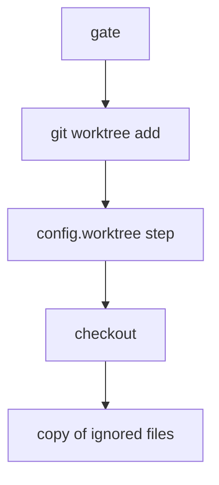

# git.worktree_create

`git.worktree_create` makes a linked git worktree for a session. It creates a new branch, or attaches the worktree to one that exists, then checks out the tracked files and copies some ignored files into it. [After a failure](#after-a-failure) lists what a failed create can leave.

An untagged rule on this page matches the reference as measured on `5fd08069` or on an earlier build.

## Request

```json
{"baseRepo": "/repo", "branchName": "feature", "worktreePath": "/repo/.claude/worktrees/w1"}
```

| Parameter | Required | Meaning |
|---|---|---|
| `baseRepo` | yes | The repository. |
| `branchName` | yes | The branch to create. It is required with `existingBranch` too. An attach that succeeds does not use it. |
| `worktreePath` | yes | The directory of the new worktree. It must not exist. |
| `sourceBranch` | no | The name that the new branch starts from. The default is the current branch. An attach does not use it. |
| `existingBranch` | no | A local branch to attach to. If it names no local branch, or the attach fails, the daemon creates `branchName` instead. |
| `worktreeRoot` | no | A location outside the repository. Windows refuses it with `unsafe_path`. |
| `timeoutMs` | no | A deadline that starts before the first git call. It stops the read-tree call. The daemon tests it after the add and the copy step. The stop of the settle step from that start is measured (`683cc6a9`, Linux). For the other tests that start is claustrum's own, not measured. A wait behind another create of the repository does not count (claustrum's own). No value or `0` sets none. |
| `shadowDirOff` | no | `true` turns off, for this request, the filter rule of the checkout, the daemon's own read of the repository's git config, and the settings copy. Git requests that start meanwhile get the same. A command that starts meanwhile gets no copy (measured on Linux). Other values do nothing. |

Where the worktree can go:

- Without `worktreeRoot`, `worktreePath` must be an absolute path inside `baseRepo`. The usual place is `<baseRepo>/.claude/worktrees/<name>`.
- With `worktreeRoot`, `worktreePath` must be `<worktreeRoot>/<directory>/<name>`. A root that exists must belong to the user of the daemon. Its mode must have no write bit for others, or for a group other than the private group of that user.
- Neither a component of the location nor the `<directory>` can be `.git` or `.claude-managed-worktrees`, in any letter case. The location must not resolve to `/`. It must not lie in a folder with a `.git` entry, the git directory of the repository, or a session folder. The `<directory>` level must not hold the repository or be writable by every user.
- Not measured on the reference: `.claude-managed-worktrees` in the location, a reserved `<name>`, and the owner and group tests of the `<directory>` level. claustrum refuses all of them.

## Response

Success:

```json
{"success": true, "path": "/repo/.claude/worktrees/w1", "sourceBranch": "main", "branch": "feature"}
```

`path` is `worktreePath` as sent, after the `~` expansion. `branch` is `existingBranch` after an attach, and `branchName` otherwise.

If the daemon created a branch, `sourceBranch` is the name that the start commit came from. The daemon reads that name as two refs: the local branch `<name>` and the remote-tracking ref `origin/<name>`. It fetches nothing. If both exist, it selects `origin/<name>` in most states. The response holds the name as sent. If the name matches neither ref, that is not an error. The branch then starts at HEAD, and `sourceBranch` is the current branch. On a detached HEAD the response then has no `sourceBranch`.

Failure:

```json
{"success": false, "error": "<text>", "errorCode": "<code>"}
```

Decide by `errorCode` first.

| `errorCode` | Meaning |
|---|---|
| `unsafe_path` | The daemon refuses a path. For example, `worktreePath` is relative, has a `..` component, is outside `baseRepo`, or exists. A `worktreeRoot` that is not safe gives this code too. So does a worktree that git registered in an unexpected place. |
| `symlinked_component` | A directory between `baseRepo` and the worktree is a symbolic link. |
| `not_a_repo` | `baseRepo` is not a git repository, as with `refs` 0600 (build `52d82f0a`, Linux and macOS), or git itself does not accept it. A bare `baseRepo` gets this code too while the daemon works on its settings copy. |
| `nested_base_repo` | `baseRepo` is inside a directory of managed worktrees, or the daemon does not accept it as a trust root. |
| `mkdir_failed` | The daemon cannot create a directory for the worktree. Or, with `worktreeRoot`, a git call or a `.git` test failed first. |
| `worktree_add_failed` | `git worktree add`, the checkout or the `config.worktree` step failed. The text holds the message of git, or a refusal of the daemon before the add. A `git worktree add` that runs 2 minutes is stopped. |
| `repository_only_filter` | The checkout needs a git filter that only the git config of the repository defines. See [Git filters](#git-filters). |
| `timeout` | The deadline of `timeoutMs` expired. |

A git config of the repository that the daemon does not accept gives `worktree_add_failed`, and nothing is made. The texts are in [Repository config refusals](git-rules-config.md#repository-config-refusals). Three failures of the settings copy do the same: a failed test of the host git, a failed call about the repository, and no folder for the copy.

## Error texts

Each text is in `error`, unless the row names a JSON-RPC error. The shared texts are in the [error-string catalogue](errors.md#error-string-catalogue). A row with no mark holds a text of the reference, measured on Linux. A mark such as "measured on macOS" limits its sentence to that system. A sentence that names systems without "measured" holds on each one.

### Request, path, folder and post-add refusals

| Text | Code and cause |
|---|---|
| `branchName is required` | JSON-RPC error `-32602` |
| `not a git repository` | `errorCode:"not_a_repo"` |
| `refusing to create worktree: <p> {is a relative path / contains a ".." component / has a component Windows reads as a different name (trailing dot or space, or a colon) [Windows] / is not inside the repository <repo>; … / already exists, …}` | `errorCode:"unsafe_path"`. The spelling refusal is Windows only and comes before containment. On Linux and macOS the `already exists` text cleans `<p>`. It resolves the symlinks of the parent folder of the leaf and keeps the last name. `<repo>` is `baseRepo` as sent, so an absent `baseRepo` gives the empty string. With `worktreeRoot`, the first two texts also refuse a relative, absent or `..` `baseRepo`, and `<p>` is then `baseRepo` as sent |
| `refusing to create worktree: <root> is a filesystem root; choose the worktree location by its absolute path, without "..", beneath the filesystem root` | `errorCode:"unsafe_path"`, Linux and macOS, with `worktreeRoot`. A root of `/`, `//` or `/.` is refused, also with the folder gone and for a daemon that runs as root. `<root>` is `worktreeRoot` as sent. A root that is another mount point passes. A relative `worktreePath` gets its own text first. A root with a `..` component that cleans to `/` gets the `..` text (from the code, not measured). Windows refuses every `worktreeRoot` first. Nothing is created |
| ``refusing to create worktree: `<c>` is a symbolic link; a symlinked .claude or .claude/worktrees …`` | `errorCode:"symlinked_component"`, for a symlinked ancestor component under the repo. `<c>` is in backticks, and a path with a backtick is quoted as in Go. Build `be1c1ca5`, measured on Linux, macOS and Windows. A path over 300 bytes is cut there (not measured) |
| `failed to create parent directory: "" does not name a directory` | `errorCode:"mkdir_failed"` (empty `worktreePath`, without `worktreeRoot`) |
| `failed to create parent directory: <repo>\<component> is not a directory` | `errorCode:"mkdir_failed"`, Windows, when a directory between `baseRepo` and the leaf is a junction. `<repo>\<component>` is the path of the first junction. Nothing is created: no directory, no entry, no branch. claustrum also refuses a non-symlink reparse point that is not a junction the same way (not measured) |
| `refusing to create worktree: <root> is the repository <repo> or inside it; a worktree location must be outside the repository` | `errorCode:"unsafe_path"`, with `worktreeRoot`. A root that is `baseRepo` or lies beneath it by whole components is refused. `<B>/Tx` beside `<B>/T` passes. `<root>` and `<repo>` are as sent. claustrum cleans both paths first, as on remove (not measured on create). Nothing is created. Measured on Linux and macOS. |
| `refusing to create worktree: <root> passes through <dir>, which is writable by <who> without the sticky bit (mode <mode>), so they could replace what is beneath it; choose a location under directories only you (or the system) control, or remove the extra write permission (chmod go-w)` / `refusing to create worktree: <root> passes through <dir>, which is owned by uid <uid>, neither you nor the system; choose a location you reach through your own directories` | `errorCode:"unsafe_path"`, Linux and macOS, with `worktreeRoot`. It tests each directory above the root, not the root. For a symlinked root, those above its target count too. The second text names an owner other than uid 0 and the daemon's user, also with the sticky bit set. The first names a directory that its group or every user can write without the sticky bit. A group-write bit passes for the private group of the daemon's user, as in the root's own write test. uid 0 gets no exemption from the write tests. `<dir>` is the first failing directory of the walk from `/`, with its symlinks resolved, also one that the daemon cannot search. A symbolic link above the root that another user owns gets the second text. `<dir>` is then the link as written in the root. `<root>` is `worktreeRoot` as sent. `<who>` is "its group", "every user on this host" or "its group and every user on this host". `<mode>` is four octal digits of the permission bits, so 2775 prints `0775`. `<uid>` prints unsigned, for example 4294967294 on macOS. On macOS a firmlink spelling of the root names `/System/Volumes/Data`. A missing level or another failed resolve ends the walk with no refusal. A create without `worktreeRoot` and `git.worktree_remove` run no ancestor test. Nothing is created. The comment of `worktreeRootAncestorRefusal` lists the cases that are claustrum's own choice |
| `refusing to create worktree: <root> leads into the repository <repo> (at <at>); a worktree location must be outside the repository` | `errorCode:"unsafe_path"`, with `worktreeRoot`, Linux and macOS. The root passes the tests above but leads into the repository. That is the git top level of `baseRepo`, the main checkout or the git directory, also a separate one. The [remove row](git-worktree-remove.md#error-texts) of this text gives the test. claustrum compares file identity as on remove (not measured on create). When the ancestor test refuses the same root, its text answers. `<repo>` is `baseRepo` as sent. Nothing is created |
| `refusing to create worktree: <root> leads into <wt>, a worktree of the repository <repo> (at <wt>); a worktree location must be outside the repository's checkouts` | `errorCode:"unsafe_path"`, with `worktreeRoot`, Linux and macOS. The root lies in a linked worktree `<wt>` of the repository. The [remove row](git-worktree-remove.md#error-texts) of this text gives the test. `<repo>` is `baseRepo` as sent. A listed worktree whose folder is gone refuses too. The create makes that folder first, with mode 0700. Nothing else is created |
| `refusing to create worktree: <root> is inside a git checkout (<dir> has a .git entry); a worktree location must be outside every checkout, so that no session working in one can reach it — choose a directory that is not part of any repository` | `errorCode:"unsafe_path"`, Linux and macOS, with `worktreeRoot`. A directory from `/` down to the root holds a `.git` entry of any kind. A missing directory is skipped. The ancestor text answers first at the same directory. `<root>` is `worktreeRoot` as sent, with a trailing slash or `//` kept. `<dir>` is the highest such directory, resolved and cleaned. Nothing is created |
| `refusing to create worktree: <dir> is itself a git checkout (it has a .git entry); a worktree location must be outside every checkout` | `errorCode:"unsafe_path"`, Linux and macOS, with `worktreeRoot`, when the `<directory>` level holds a `.git` entry. `<dir>` has the symlinks of the root resolved. Nothing is created |
| `refusing to create worktree: <p> carries a .git file that does not name this repository's own worktree admin directory` | `errorCode:"unsafe_path"`, Linux and macOS, after a successful add. `<p>` is spelled as in the `already exists` text. The `gitdir:` path of the new `.git` file is not in a folder named `worktrees`. Or it names no entry of the `worktrees` folder of `baseRepo`, or a symbolic link. Or the `commondir` file of the registration does not name the git directory by text. Or that `commondir` file or the `gitdir` record cannot be read as a file. No checkout runs and nothing is rolled back |
| `refusing to create worktree: <p> was not populated by git worktree add` | `errorCode:"unsafe_path"`, Linux and macOS, after a successful add, when the git directory of `baseRepo` has no `worktrees` folder. A daemon `GIT_COMMON_DIR` of another repository gets it too. In the state `shadow` it also answers a `.git` that no longer names the held git directory right after the add. That `.git` is no real directory that passes the gate. No checkout runs and nothing is rolled back |
| `refusing to create worktree: <p> carries a .git file naming an admin directory whose own record is of a different worktree` | `errorCode:"unsafe_path"`, after a successful add. The `gitdir` record of the registration does not name `<p>/.git`. A record with a slash or a blank at its end, a `/./` part or a double slash names it. An expired `timeoutMs` gets the same answer. No checkout runs and nothing is rolled back |
| `git worktree add failed (verification): could not verify the worktree's registration: git did not report its spelling of the path (entry <name>); retry` | `errorCode:"worktree_add_failed"`, Linux and macOS. The state of the row above, and git fails the `rev-parse --show-toplevel` call that follows. `<name>` is the entry that the `.git` file names. The leaf, the one new entry of the `worktrees` folder and the new branch go. claustrum's own, not measured: the folder has one new entry, and no time limit stopped the call |
| `refusing to create worktree: <p> carries a .git file naming an admin entry other than the one just created for it` | `errorCode:"unsafe_path"`, after a successful add. The registration is not the one new name of the `worktrees` folder since the listing before the add: there are two new entries, or none. On Windows a leaf `.git` file of another staged entry gets it before the move. Only the leaf and the branch go then. claustrum's own, not measured: a listing that fails gets it, and a refusal of the four rows above comes first. Otherwise no checkout runs and nothing is rolled back |
| `refusing to create worktree: <p> has no .git file` / `refusing to create worktree: <p>/.git is not a regular file` / `refusing to create worktree: <p>/.git does not name a git dir` | `errorCode:"unsafe_path"`, Linux and macOS, after a successful add. The `.git` entry of the new worktree is gone, is no regular file, or does not start with `gitdir: `. The registration and the branch stay, and an empty leaf goes |
| `refusing to create worktree: <p> is no longer the directory that was created for the worktree` | `errorCode:"unsafe_path"`, Linux and macOS, before the checkout. Another folder is at the path of the leaf. Nothing is checked out or rolled back |
| `git worktree add failed: cannot prepare the repository's worktrees directory: "<git dir>/worktrees" is not a directory` / `git worktree add failed: cannot prepare the repository's worktrees directory: openat worktrees: permission denied` / `git worktree add failed: cannot list the repository's worktree entries: "worktrees" is a link or a file where Claude needs a real directory; put the directory itself in its place` | `errorCode:"worktree_add_failed"`. In the state `shadow` on Linux and macOS, a symbolic link or a file at `worktrees` gets the first text. A folder there that cannot be opened gets the second. With `"shadowDirOff":true` a link or a file there gets the third. On Windows a junction or a directory symbolic link gets the third too. A file there on Windows is claustrum's own, not measured. No `worktree add` runs, and no leaf or branch stays. Measured on Linux and macOS. |
| `failed to create parent directory: lstat <path>: <errno text>` | `errorCode:"mkdir_failed"`, Linux and macOS, with `worktreeRoot`. A root symlink names a missing target, and `<path>` is that target. Or a directory from `/` down to the root cannot be searched, and `<path>` is `<dir>/.git` for the highest such directory. A directory above the root that fails the ancestor test gets the ancestor text instead. Nothing is created |
| `failed to create parent directory: <path>: not a directory` | `errorCode:"mkdir_failed"`, Linux and macOS, with `worktreeRoot`. The deepest existing part of the root is not a directory after its symlinks are resolved. `<path>` is that resolved path: the root, a path above it, or the file that a root symlink names. A regular file above the root gets this text, not the ancestor text. Nothing is created |
| `failed to create parent directory: <path> is not a directory` | `errorCode:"mkdir_failed"`, Linux and macOS. Without `worktreeRoot`, an existing component above the leaf is not a directory. `<path>` is its full path, with the symlinks of the repo resolved and with `//` and `/./` removed. With `worktreeRoot`, the `<directory>` level exists and is not a directory, and `<path>` is its path with the root resolved. A `<directory>` that is a symlink gets the symlink refusal first. Nothing is created. On Windows, without `worktreeRoot`, a file in the path keeps the `os.MkdirAll` text, `mkdir <path>: <OS error>` (not measured) |
| `failed to create parent directory: statat .: <errno text>` | `errorCode:"mkdir_failed"`, Linux and macOS, without `worktreeRoot`. An existing `.claude` or `.claude/worktrees` cannot be searched, also when nothing is left to create |
| `failed to create parent directory: statat <name>/.git: <errno text>` | `errorCode:"mkdir_failed"`, Linux and macOS, with `worktreeRoot`, when the `<directory>` level exists and cannot be searched. `<name>` is its last component |
| `failed to create parent directory: mkdirat <name>: <errno text>` | `errorCode:"mkdir_failed"`, Linux and macOS, when a missing directory above the leaf cannot be created. Without `worktreeRoot`, `<name>` is the last component of that directory. With `worktreeRoot`, `<name>` is its path relative to the deepest directory that existed before the call, for example `a/b`. A directory that the call made before the failure stays. Measured with `permission denied` and `file name too long`. Other errno texts take the same shape (not measured) |
| `failed to create parent directory: cannot mark <dir> as a worktree location: openat .claude-managed-worktrees: <errno text>` | `errorCode:"mkdir_failed"`, Linux and macOS, with `worktreeRoot`, when the marker cannot be created and no entry of that name exists. `<dir>` is the `<directory>` level with the symlinks of the root resolved. The leaf is not made |
| `refusing to create worktree: <root> leads into a session worktree (at <p>; beneath .claude/worktrees, or beneath a directory holding a .claude-managed-worktrees marker); a worktree location must be outside every session's worktree` | `errorCode:"unsafe_path"` |
| `refusing to create worktree: <root> would be made inside a session worktree or its per-repository directory (at <p>; …` | `errorCode:"unsafe_path"` |
| `refusing to create worktree: <root> is itself a per-repository worktree directory (it holds a .claude-managed-worktrees marker); choose the directory above it, or another location` | `errorCode:"unsafe_path"` |
| `refusing to create worktree: <dir> is writable by <who> (mode <mode>); choose a directory only you can write to, or remove the extra write permission (chmod go-w)` | `errorCode:"unsafe_path"`, for the root, and for the `<directory>` level |
| `failed to create parent directory: cannot determine the repository's work tree: <exec error>` | `errorCode:"mkdir_failed"` |
| `failed to create parent directory: cannot list the repository's worktrees: <exec error>` | `errorCode:"mkdir_failed"` |

### Add and checkout failures

| Text | Code and cause |
|---|---|
| `git worktree add failed: <text>` | `errorCode:"worktree_add_failed"`. `<text>` is made from git's stderr by the [text rule](git-rules-trust.md#the-cannot-run-and-hooks-refusal-texts). claustrum's text does not start with git's graft-file `hint:` lines. The rollback runs no git call and removes the leaf only if it is empty. A branch that existed before is not deleted. A failed add answers this frame also when the caller `timeoutMs` expired during the add (measured on macOS) |
| `git worktree add failed (completing the new worktree's git files): <cause>` | `errorCode:"worktree_add_failed"`, when the `config.worktree` step after the add fails. On Windows a failed staging step gives it, such as `git registered <n> worktrees where one was expected; try again` or `the repository already has a hundred worktrees called "<name>"; remove some (git worktree prune, git worktree remove)`. No checkout runs, and it rolls back as a failed checkout. It wins over an expired `timeoutMs`. Linux, macOS and Windows |
| `git worktree add failed (completing the new worktree's git files): this repository's git config cannot be used: git did not finish reading it within 30 seconds; try again` | `worktree_add_failed`. The listing of `config.worktree` after the add ran 30 s. It rolls back as a failed checkout |
| ``cannot add a worktree: `<p>` is still registered in this repository as a locked worktree (entry "<name>"); unlock it first (git worktree unlock '<p>', then git worktree prune), or use another folder`` | `errorCode:"worktree_add_failed"`. The `gitdir` record of a locked entry `<name>` names the gone leaf. Windows quotes the hint path with double quotes. No entry and no file is removed. Build `be1c1ca5`, measured on Linux, macOS and Windows. A path over 300 bytes is cut there (not measured). The create refuses before the add, so no branch is made (measured on Linux and macOS). A blank keeps the hint (measured on Linux). With a daemon `GIT_COMMON_DIR` the check is off and git decides (claustrum's own) |
| ``cannot add a worktree: `<p>` is still registered in this repository as a locked worktree (entry "<name>"); unlock it with git worktree unlock, giving the folder's path (git worktree list shows it), then git worktree prune, or use another folder`` | The same for a path with a `$` (build `be1c1ca5`, measured on Linux, macOS and Windows), or a `'` or a backslash (measured on Linux). A `'` on Windows is not measured |
| ``cannot add a worktree: `<p>` is still registered in this repository as a worktree (entry "<name>"); clear the stale registration first (git worktree prune), then try again`` | The same for an entry with no `locked` file. It shows for two or more entries, because the stale step removes a single unlocked one first, or for a Windows entry that the step keeps. The first by name counts (not measured). An entry whose folder holds files does not count (claustrum's own). Build `be1c1ca5`, measured on Linux, macOS and Windows |
| `git worktree add failed: <fallback text> (attaching to the existing branch <b> was refused first: <attach text>)` | `errorCode:"worktree_add_failed"`, when the attach add for `existingBranch` fails and the fallback `-b <branchName>` add fails too. The text rule makes each text on its own, each with its own 512-byte cap (measured on macOS) |
| `git worktree add failed (checkout): <text>` | `errorCode:"worktree_add_failed"`, when the `read-tree` checkout fails. The text rule and the `hint:` rule apply. With a settings copy a `<text>` that holds `smudge filter lfs failed` after the cut gets `. Claude doesn't use ssh, credential, or proxy settings from this repository's own git config. If the download needs one and you trust that setting, copy it into ~/.gitconfig on the remote machine, then try again.` after it. The new directory is removed. The branch the call created goes only when another ref reaches its tip (see [The branch step](git-rules-calls.md#the-branch-step)). In attach mode the attached branch is kept. A failed placement of the index answers this frame too. On Linux and macOS its OS error is `openat <registration name>/index: permission denied` or `open <temporary directory>/index: no such file or directory`, or claustrum's own `the registration <p> is not the folder that was tested after the add` (D24, not measured). On Windows it is `openat index: <cause>`, or claustrum's own `the registration <p> is not the folder that was moved into place` (D24, not measured) |
| `Claude doesn't run the "<name>" git filter, because only this repository's own git config defines it. If you trust that filter, copy the [filter "<name>"] section from that config (usually .git/config) into ~/.gitconfig on the remote machine, then try again.` | `errorCode:"repository_only_filter"`, in the state `shadow`. A quote mark in `<name>` has a backslash before it. Linux and Windows. |
| `git worktree add failed (checkout): this repository's git config cannot be used: a filter defined only there has a name longer than 200 bytes (it starts "<first 40 bytes>"); define it in ~/.gitconfig on the remote machine, or rename it` | `errorCode:"worktree_add_failed"`, in the state `shadow`, for such a filter with a name over 200 bytes. It rolls back as a failed checkout. Linux and Windows |
| `git worktree add failed (checkout): this repository's git config cannot be used: it defines more than 64 filters` | `errorCode:"worktree_add_failed"`, in the state `shadow` with a settings copy, when the repository config has more than 64 filter names. A name with a `smudge` key counts (Linux, macOS and Windows), and so does one with only a `clean` key (Linux and macOS). A name with only other keys counts too (claustrum's own). No read-tree call runs, and it rolls back as a failed checkout. The text wins over the texts of a name with `=` and of a name over 200 bytes. A failed config listing wins over it |
| `git worktree add failed (checkout): Claude could not read your own git config on the remote machine (<cause>). Run git config --list there to see the problem.` | `errorCode:"worktree_add_failed"`, in the state `shadow` with a settings copy, when the config listing right before the checkout fails. No read-tree call runs, and it rolls back as a failed checkout. `<cause>` is `exit status 1` for a listing that exits 1 (Linux, macOS and Windows). On Windows a `.git` that became a regular file during the first listing can make the second listing fail with `exit status 128`. That holds also while a child holds stdout past 30 s (claustrum's own, not measured). A git still running at 30 seconds stops as in [Time limits of git calls](git-rules-calls.md#time-limits-of-git-calls). Unless it exits 0, `<cause>` is then `git took too long: Claude stopped git config after 30 seconds; try again`. An exit 0 counts, also with stdout held past 30 s. The `timeoutMs` of the caller does not end the listing. |
| `git worktree add failed (checkout): config-defined hooks could not be pinned off; git not run: listing the configuration in force: <detail>` | `errorCode:"worktree_add_failed"`, in the state `shadow`, when the first config listing after the add fails. One `git version` call runs first, and the rollback follows. If that `git version` call fails too, the text after `(checkout): ` is `git cannot run on this host; git not run: <exec error>: <git text>` (measured on Linux). The rest is measured on Linux and macOS. |
| `git worktree add failed (checkout): this repository's git config cannot be used: the filter "<name>" is defined only there, and Claude cannot handle "=" in a filter's name; define it in ~/.gitconfig on the remote machine, or rename it` | `errorCode:"worktree_add_failed"`, in the state `shadow`, for such a filter with `=` in its name. It rolls back as a failed checkout |
| `git worktree add failed (checkout): this repository's git config cannot be used: it names a program for git-lfs ("<key>"); remove that setting, or put it into ~/.gitconfig on the remote machine` | `errorCode:"worktree_add_failed"`, in the state `shadow` and only with no settings copy. A path uses the filter `lfs` of the user or the system config. The config of the repository has the key `<key>`, a program key of git-lfs. It rolls back as a failed checkout. The text is claustrum's own |
| `git worktree add failed (checkout): the git filter "<name>" has values in this repository's git config that no option of git can replace for the checkout` | `errorCode:"worktree_add_failed"`, in the state `shadow` (claustrum's own, not measured). With no settings copy it answers a repository `process` key beside an outside filter with none. It also answers a shared name with `=` and a name that is not valid UTF-8 there. With a copy it answers a shared name with `=` or one that is not valid UTF-8 where the repository adds only `required = true`. With a copy the reference answers success for the `process` key, and claustrum follows it |
| `git worktree add timed out after <n>ms (deadline expired {before the checkout started / during the checkout): <text> / after the checkout finished})` | `errorCode:"timeout"`, from the caller-supplied `timeoutMs`. `<text>` comes from the stderr of the killed git, by the same text rule |
| `<frame>; and the undo could not finish for <leaf>: {the worktree directory, its registration, and the branch all remain; remove them by hand before retrying (RemoveAll <entry>: <OS error>) / the worktree directory remains (re-populated while undoing?); remove it by hand before retrying (removeat <leaf base name>: <OS error>)}` | Appended to the checkout-failure frame and to each `timeout` frame when a step of the rollback fails. The `errorCode` stays as it was. The texts in braces are measured on Windows only. In attach mode the first text reads `the worktree directory and its registration both remain` instead, because the call made no branch. On Linux and macOS a registration that cannot be deleted gives `the worktree registration and the branch remain; remove them by hand before retrying (RemoveAll <registration name>: <OS error>)` instead, with the leaf removed. In attach mode it reads `the worktree registration remains; remove it by hand before retrying (RemoveAll <registration name>: <OS error>)`. The text in the parentheses of a registration text can be claustrum's own. No rmdir text joins either one |
| `<frame>; and the undo could not finish for <leaf>: <branch part>` | Appended when the branch step of the rollback keeps the branch that the call made. After a failed leaf rmdir, the branch part follows the rmdir text after `; `. Some cases also add `"branchKept":true` after `errorCode`. [The branch step](git-rules-calls.md#the-branch-step) gives each `<branch part>` and each case |

## The main steps



## The held git directory

In the state `shadow` a create holds the git directory of `baseRepo` open from its gate to its reply. The gate is the trust check of the git directory and the daemon's own read of its config.

- The git directory must be a real directory at the gate (the test is claustrum's own). On Windows a junction or a directory symbolic link there is refused, on every git method without `"shadowDirOff": true`. With that member both link kinds pass, and git works behind the link. On Linux and macOS a `.git` that is a symbolic link before the request is resolved, and the daemon holds its target.
- The daemon's own deletes, renames, new folders and file writes inside the git directory go through the held folder. A folder put at the path during the create gets none of them, except the one the hold moves to ([Rare states](#rare-states)).
- These go by the path: git itself, a host in the state `fallback-git` or with no run folder, and a request with `"shadowDirOff": true`. So does a request that starts while such a request runs, until a later gate before its first good add (claustrum's own). Before that gate, or with a `worktrees` folder outside the held folder, the stale-registration step goes by the path too (from the code).

## The settings copy

Git calls of the daemon read its copy of the repository's git settings. [The settings copy](git-rules-settings-copy.md#the-settings-copy) has the states, the texts and the folder. For this method:

- A missing `<git dir>/worktrees` is made before the add, with mode 0777 less the umask. It stays after a failed add. On Linux and macOS a last `core.sharedrepository` line of the copy other than `umask` sets its mode. macOS is not measured.
- With `extensions.worktreeConfig` the new worktree gets the `config.worktree` file of `<git dir>`, or of a linked `baseRepo`, less `core.bare` and `core.worktree`.
- While a `"shadowDirOff": true` request runs, the checkout has its index in `claude-ssh-index-<n>` of the temporary folder.
- In the state `shadow`, a failed `rev-parse --absolute-git-dir` stops the create with `git worktree add failed: cannot locate the repository's git directory: exit status 128`. macOS is not measured.
- On Linux and macOS, a linked worktree as `baseRepo` whose registration entry is a symbolic link gets the trust refusal after the prefix `git worktree add failed: cannot locate the repository's git directory: `. The code is `worktree_add_failed`. A path that fails the path tests or exists gets this text too (claustrum's own). Without `worktreeRoot`, the create first makes the parent folders of the worktree, such as `.claude/worktrees`. It makes them only for a `worktreePath` that passes the path tests and does not exist (claustrum's own, not measured). The trust refusal is measured on Linux only, with `extensions.worktreeConfig` and a `config.worktree` file. Other forms are not measured.

## Git filters

In the state `shadow`, a checkout that needs a filter that only the repository config defines, with a value that does not pass, fails the request. The texts are in [Error texts](#error-texts).

In the state `fallback-git` git runs the filters, and this section does not apply. In the state `shadow`:

- A filter is defined where its `smudge` or `process` key has a value. A file that the repository config includes counts as that config, also through `includeIf`, whatever its condition. With a settings copy, a last `smudge` or `process` line with no `=` in .git/config is a definition too.
- A filter of the user or system config or of the daemon environment runs with its values, also if the repository defines it. With a settings copy, an outside `process = cat` is no outside definition, so a repository `smudge` command is refused.
- With a user `lfs.storage` the checkout gets no `lfs.storage` item of the daemon (Linux, macOS and Windows). A failing user `smudge` fails the request where the repository adds only `required = true`, `yes` or `1`.
- Three repository values pass: `smudge = cat` under each name, and `git-lfs smudge -- %f` and `git-lfs filter-process` under `lfs`. With a settings copy `git-lfs smudge --skip %f` passes under `lfs` too. A filter whose values are all `cat` gets no item.
- With a settings copy, a `smudge` value that does not pass refuses the filter, in .git/config or in an `includeIf` file, in either order. In .git/config only the last value counts. A plain include file and `config.worktree` count the same way (not measured).
- With a settings copy, a refused name that is not valid UTF-8 gets success on Windows. On Linux it gets the checkout text of git less those bytes.
- With a settings copy, a repository-only `lfs` filter with the `git lfs install` lines gets those lines as items. A git-lfs program key of the repository refuses nothing, and its program does not run. With no settings copy such a key turns the filter `lfs` off (claustrum's own).
- A failed checkout text with `smudge filter lfs failed` gets a note about ssh, credential and proxy settings after it.

## The settle step

In the state `shadow` a good checkout gets one more call: `git diff-files --quiet --ignore-submodules=all` (`683cc6a9`, Linux, macOS and Windows).

- After exit 1 the reply waits until 1.1 s after the checkout (claustrum's own). `683cc6a9` answers 0.39 s to 0.98 s after the call.
- The call runs only with 10 s or more left. It stops 10 s before the deadline, after 1 s at least, and a stop changes nothing (measured on Linux). The time left is read right before the call (claustrum's own). With no `timeoutMs` the limit is that of the other calls of the request (claustrum's own).
- The 1.1 s become 2.2 s if the Lstat of `.git` in the new worktree fails or its mtime has no nanoseconds. The wait ends with the request, and the call limit is at most that of the other calls (claustrum's own, not measured).
- A git without `--attr-source` gets no call (measured on Linux).

## The copy of ignored files

After the checkout, the daemon copies two sets of files from `baseRepo` into the new worktree:

- The ignored files that the root file `.worktreeinclude` names. That file uses the syntax of `.gitignore`.
- The ignored files under `.claude/`.

Neither set includes `.claude/worktrees` or Claude's session state under `.claude/`, for example `checkpoints`, `mailbox` and `scheduled_tasks.json`.

Each copy is a new file with mode `0666` less the umask, not its source mode. The daemon skips symbolic links. A copy does not replace a file or a link that the checkout made.

A failed copy does not fail the request. If the deadline of `timeoutMs` expires during the copy, the request fails with `timeout`. A scan of ignored files stops at 10 minutes ([Time limits of git calls](git-rules-calls.md#time-limits-of-git-calls)). Then nothing is copied, the `.claude/` pass included (claustrum's own, not measured).

## After a failure

A request can create four things outside the worktree, and no failure removes them:

- directories above the worktree
- the registrations directory `<git dir>/worktrees`
- with `worktreeRoot`, the marker file `.claude-managed-worktrees` at the `<directory>` level
- with `worktreeRoot`, the folder of a gone worktree that holds the root

Before the add, a request can remove one stale registration in the common git directory of `baseRepo`. A stale registration is one whose `gitdir` record names the `.git` of the new worktree. If it is the one stale entry and has no `locked` file, it goes. Otherwise none goes. Nothing behind a symbolic link or a junction at `worktrees` goes (measured on Windows with `"shadowDirOff": true`, claustrum's own elsewhere). Two creates through a repository and its linked worktree add in turn.

After a good add in the state `shadow`, a create removes old staging entries of the git directory. Their name starts with `.claude-new-worktree-`, and their write time is 1 hour or more. A real folder goes as a tree. A link or a junction goes as a link, and its target stays. This is measured on Linux, macOS and Windows, on Linux and macOS since `be1c1ca5`. The 1 hour edge and the name rule are measured on Linux.

| Failure | What stays of the worktree |
|---|---|
| A refusal of the request or of a path (`not_a_repo`, `nested_base_repo`, `symlinked_component`, and `unsafe_path` for a path) | Nothing, except the folder of a gone worktree above. |
| A refusal before `git worktree add` (`worktree_add_failed`), or `mkdir_failed` | Nothing. |
| `git worktree add` runs and fails (`worktree_add_failed`) | An empty worktree directory goes. Files, a registration and a branch that the failed add made stay. |
| A test of the new worktree fails after the add. On Linux and macOS the tests come before the checkout and give `unsafe_path`. A worktree directory replaced during the checkout gives `worktree_add_failed`. So does a failed test on Windows, except a `.git` file that names another staged entry. That gives `unsafe_path`. | Everything, except an empty worktree directory. On Windows, a `.git` file that names another staged entry leaves nothing: the worktree directory and the branch that the request created go. |
| The checkout or the `config.worktree` step fails, the filter rule refuses, or the deadline expires (`worktree_add_failed`, `repository_only_filter`, `timeout`). Or the text holds `; retry` before any clause of the rollback (Linux and macOS). | The worktree directory, its registration and a branch that this request created go. |

??? note "When a rollback leaves something"

    - A branch with commits that no other ref reaches stays. The response has `"branchKept": true`.
    - After a failed `config.worktree` step, a refused second config read keeps the branch without `branchKept` (Linux and macOS).
    - A failed delete ends the error text with a clause that says what remains. If the files of the worktree cannot be deleted, the registration and the branch stay. A registration that cannot be deleted keeps the branch too, on Windows only for a moved registration (not measured on Windows). On Linux and macOS in the state `shadow`, after an empty answer of git about the git directory, a registration that cannot be deleted adds no clause, and the branch step runs (claustrum's own). On Windows a registration that stays adds no clause, unless the create moved it (not measured).
    - If something replaced the worktree directory, the rollback keeps the replacement and adds no clause.

## Differences by system

=== "Linux and macOS"

    - A junction between `baseRepo` and the worktree does not apply.
    - The stale registration is removed by the rule of [After a failure](#after-a-failure). The compare keeps letter case.

=== "Windows"

    - A junction between `baseRepo` and the worktree is refused with `mkdir_failed`.
    - The stale registration goes by the same rule, after `rev-parse --absolute-git-dir`. The compare ignores letter case, measured for a create that holds its git directory. An entry whose record names a path that exists stays ([D27](../DIVERGENCES.md#d27)).
    - In the state `shadow`, git writes the registration into a short-lived folder of the daemon. The daemon copies it into `<git dir>\.claude-new-worktree-<16 hex>` and renames that folder to the first free name of `<name>`, `<name>1` to `<name>99` in `<git dir>\worktrees`. A held folder gets 2 s of retries, also past `timeoutMs`. A rename that still fails gives `worktree_add_failed`, and the rollback removes the staging folder. A failed write of the `.git` file of the worktree, and a rollback, remove the moved registration by its name. `config.worktree` and the index are new files there.

## Rare states

??? note "When the git directory is replaced during a create"

    - On Linux and macOS two swaps move the hold to a copy of the git directory, and the create goes on in the copy. One is a link to the copy at `.git` after the first call or after `rev-parse --abbrev-ref HEAD`. The other is a real copy put there while `git worktree add` runs.
    - Any other swap after `rev-parse --absolute-git-dir` answered and before the add refuses the create before the add.
    - A swap after the read-tree call fails the create with a text that starts `git worktree add failed (checkout): `. On Windows a swap after the first listing of the checkout does the same. The registration gets no index. It and the branch stay, and the text says so.

??? note "A failed step before the add"

    - In the state `shadow` on Windows, a failed step that prepares the add (for example the `worktrees` folder, the read of the registrations, the folder `.s<n>` and its copy, or a swap of `.git`) gives `git worktree add failed: cannot prepare the repository's worktrees directory: <cause>`, and no `worktree add` runs.
    - With `"shadowDirOff": true`, a link or a file at `worktrees` refuses the add after its listing (Linux, macOS and Windows). A file there on Windows is not measured.

## Differences from the reference

Divergences of this method:

- [D2](../DIVERGENCES.md#d2): a delete refuses a path that is the home directory or holds it.
- [D24](../DIVERGENCES.md#d24): a rollback and the index placement leave a registration directory that something replaced. On Windows a rollback after a swap of the `.git` file of the worktree runs no git call.
- [D27](../DIVERGENCES.md#d27): on Windows the stale step keeps an entry whose record names a path that exists.
